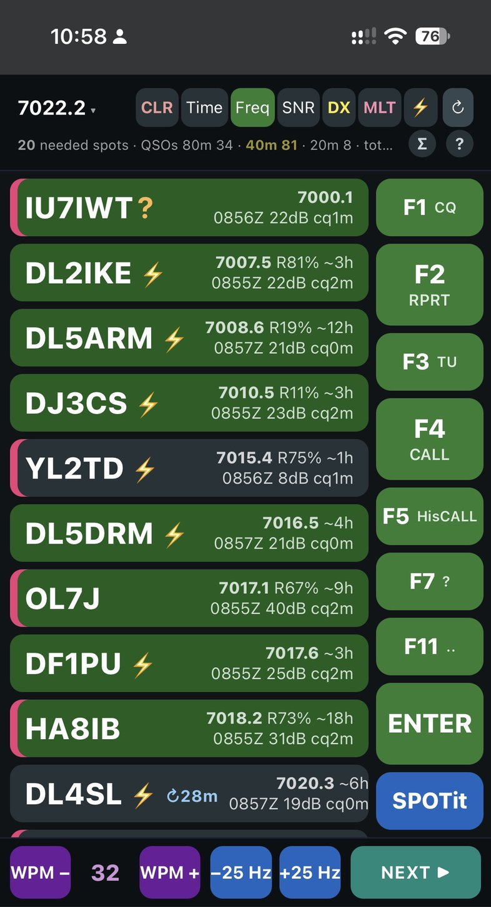
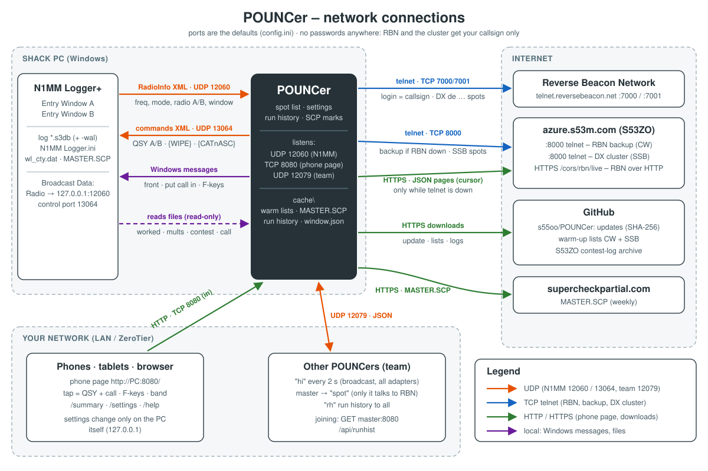
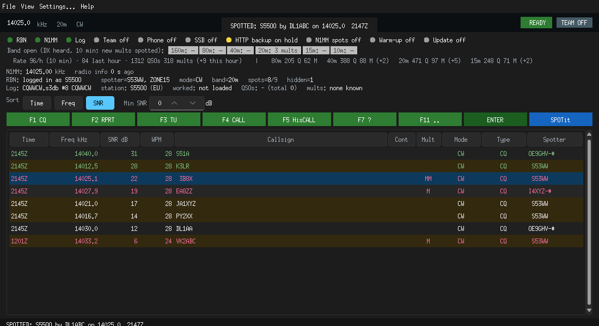

# POUNCer

**Search & pounce helper for N1MM Logger+ contesting.** POUNCer follows the
band your radio is on and shows who is calling CQ there right now - live
**Reverse Beacon Network** spots from a chosen skimmer (default **S53WW**) on
CW, and **DX-cluster** spots on SSB. Each station is marked with what helps you
decide: new multiplier, already worked, and whether it usually runs for hours
or only briefly (from 5 years of contest logs). **One tap** tunes the radio -
radio A or B in SO2R / SO2V - and puts the call into N1MM's Entry Window.
Use it on the PC, or on a phone or tablet next to the radio; several
operators' POUNCers share one feed as a team.

Windows (POUNCer.exe) and macOS; nothing to install - put the exe and
`config.ini` in a folder next to N1MM and start it.

<p align="center"></p>

*The phone page in a contest (SO2R): radio **A** on 14043.0 with **B**
(7013.0) under it, the **A / B** key, CLR / Time / Freq / SNR / DX / MLT / ⚡
sorting, **S** = slave in a team, "backup skimmers" while S53WW was quiet.
Tiles: green = strong (20 dB+), ⚡ = rare CQ, run % and hours from past
logs (R58% ~9h), first heard, SNR and how long it has been calling (cq2m);
yellow frame = the station you tapped last, blue ring = the radio is on it. F-keys on the right, WPM / ±Hz / NEXT at the
bottom.*

## How it works

<p align="center"><a href="docs/NETWORK.md"></a></p>

*All network connections (N1MM UDP, RBN / cluster telnet, HTTP backup, team,
phone page, downloads) with their ports and message formats:
[docs/NETWORK.md](docs/NETWORK.md).*

* **Own call** - taken from the open N1MM log's *Change Your Station Data*
  (follows the log you open); your own spots are never listed, and EU/DX
  colouring is from that call's continent.
* **RBN** - a telnet client connects to `telnet.reversebeacon.net:7000`, logs in
  with your callsign (from N1MM unless `[rbn] callsign` is set), and keeps only the spots whose spotting node matches the
  configured `spotter` (e.g. `S53WW`). By default it is **CW only**; the
  `[rbn] follow_modes` option can additionally show RTTY (port 7000) and
  FT8/FT4 (port 7001).
* **N1MM radio info** - N1MM broadcasts an XML `<RadioInfo>` packet on UDP port
  **12060**. POUNCer reads the frequency/mode from it and uses the band to
  filter the spots it displays.
* **N1MM control** - clicking a spot sends XML to UDP port **13064**:
  * `<radio_setfrequency>` to QSY the radio.
* **Callsign entry** - the callsign is typed with simulated keystrokes
  (`SendInput`) into the focused N1MM Entry Window (Alt+W to wipe, then the
  characters). No N1MM transmit command is ever sent, so the callsign is never
  sent over the air. The `[n1mm] focus_n1mm` option brings the Entry Window to
  the foreground first so the keystrokes land in the callsign box.
* **EU / DX** - each spotted call is looked up in N1MM's own country file
  (`SupportFiles\wl_cty.dat`). Stations outside your continent (EU for S5)
  are DX: their callsign is **yellow** on the phone page
  (EU calls white), plus a **Cont** column and light-orange rows in the main
  window.
* **Worked calls** - N1MM logs are SQLite (`.s3db`) files, and each file can
  hold many contests. POUNCer opens the database N1MM currently has open
  (read-only, auto-detected from `N1MM Logger.ini`) and considers **only the
  contest N1MM has open** (`Contest NR=` in the ini), so QSOs from other
  contests are not treated as worked. Spots whose callsign is already worked on
  the **same band and mode** are hidden. The status line also shows how many
  QSOs the open contest has per band (the band you are on is highlighted) and
  the total. The log is re-read every few seconds -
  and whenever you switch contests - so changes take effect quickly.
* **No log open** - if N1MM Logger+ is not running, its ini names no log, or the
  named `.s3db` is missing, the phone page shows an orange **"open a log in
  N1MM"** banner (and the main window says so in its Log line). Spots are still
  shown, but nothing can be hidden as worked. POUNCer looks again every 2 s, so
  the banner clears on its own once you open a log; the **Reconnect** button
  (banner, the **Log** button next to Sort, or *File > Reconnect log* in the
  main window) re-reads which log N1MM has open immediately.
* **Touch / big-button view** - the phone page in your PC's default browser
  (touch screen, second monitor): *View > Phone page in the browser* in the
  main window opens it (or set `[ui] touch_view = true` to open it at startup).
  The old separate Tk touch window is gone - one view for everything.
* **Phone view (web)** - a small local web server (stdlib only) serves the same
  needed spots as big tap tiles for a phone/browser. Tapping a tile QSYs and
  enters the call on this PC. Open
  `http://<pc-ip>:8080` - the exact URL is shown on the **Phone view** line of
  the main window: the ZeroTier address if ZeroTier is running, otherwise the
  LAN address, plus the port it listens on.
  Binds to all interfaces, so it works over your LAN and over ZeroTier/VPN for
  remote access. LAN/VPN only, no password. **Sort: Time / Freq / SNR** buttons (**CLR** in front clears all spots, with Undo)
  in the top header row reorder the tiles (the choice is remembered in the
  browser); the **DX** button next to them puts DX spots on top, still in that
  order, and **MLT** puts new multipliers on top (double, then single; magenta
  bar on the tile - thick = double). The station your radio is tuned to
  (within 0.5 kHz) has a light-blue outline. **Hold a tile for 2 s** to remove
  that call from the list (with Undo); the station you tapped keeps a yellow
  border until you tap another. The **footer** has **WPM − / WPM +** on the
  left (N1MM PgDn / PgUp = CW speed) and **−25 Hz / +25 Hz** in the middle
  (move the VFO via N1MM; step = `[ui] tune_step_hz`), and **NEXT ▶** on
  the right: the next station of the list in the order shown (after the one
  you tapped last; at the end it starts again at the top) - QSY and call,
  like tapping its tile. None of them transmit.
  The **?** at the end of the status line opens a help page explaining
  every button.
  **cq3m** on a tile = how long that station has been calling on that
  frequency (from the RBN spots, live).
  **Run history:** each tile shows `R81% ~23h` = how often that station ran
  (called CQ) and how many hours it was on the air in its logs of the last 6 years of
  the same contest (else its other contests in that mode), from S53ZO's public contest-log archive (`*` = reconstructed log,
  for stations that never sent one). The **R%** is for the **spot's band**
  when its logs have enough QSOs there (a 20 m runner that only S&Ps on 80 m
  shows its 80 m habit on an 80 m spot), else over all bands. Logs written
  without CAT (no real frequencies) still give the **hours**, just no R%; **⚡** = rare CQ (runs under 30% or on
  under 6 h) - it won't last, work it now
  (`[ui] run_history`, cached in a `cache` folder). The **⚡** header button
  sorts the rarely-running stations to the top. A new call is known in about
  a second (8 looked up at a time; instant once cached).
  **Warm-up:** at start POUNCer downloads (once, refreshed after 30 days)
  ready lists: **CW** - about 46 000 stations from CQWW CW, ARRL DX CW and
  CQ WPX CW - and, **separately, SSB** - the same contests' phone versions
  (CQWW SSB, ARRL DX SSB, CQ WPX SSB, about 61 000 stations), since who runs and for how long is
  different on SSB. Last 5 years, submitted + reconstructed logs, so the
  marks are there the moment a call is spotted; an SSB spot gets the SSB
  numbers (`[ui] warmup`; built by `server/warmlist.py`, release `warmup`).
  Stored as `cache\warm.sqlite` and `cache\warm-ssb.sqlite`;
  `cache\warm-up.txt` / `warm-up-ssb.txt` and the main window say when
  they were downloaded. QSOs logged without CAT (only the band edge, e.g.
  28000) don't count as running.
  Calls not in it are looked up live.
  Or put a ready-made **`runlist.sqlite`** next to `config.ini`
  (`[ui] run_list`) - loads at start, no download.
  Or with the optional **run list server** (`server/`, Docker, e.g. on ZeroTier;
  `[ui] run_server`) the whole CQWW list is loaded at start, so the marks
  are there the moment a call is spotted. See `server/README.md`.
  Confirmations ("Wide filter", "CW faster", Undo after a remove) pop up at
  the top, just under the header, for 5 s (tap to close). On a phone the tiles are compact one-line rows (callsign left,
  details right) so about 10 fit on screen; wider screens get two columns of
  big tiles. The TX/log key buttons sit in a column on the right of the list
  (F2 at the top, each key two rows tall); they are green and turn red when
  pressed.
  The header shows the radio frequency; **tap it to pick a band** (160, 80,
  40, 20, 15, 10 m): the list then shows **that band's spots** - the radio
  stays where it is until you **tap a station** there, which QSYs it as
  usual. "15m list · on 20m ✕" in the small line (tap it to go back to the
  radio's band); once the radio changes band the list follows it again.
* **TX / log buttons** - the main window and the phone page all
  show buttons for `[ui] fkeys` (default `F2:RPRT F3:TU F4:CALL F5:HisCALL F7:? Enter`). An F-key
  button presses that function key in the focused N1MM Entry Window, so N1MM
  sends its message - e.g. F4 normally sends `{MYCALL}`. Unlike tapping a spot,
  **F-keys transmit over the air**. The `Enter` button logs the current QSO in
  N1MM (no transmission). N1MM's documented way to do this from another program
  is to send the keystroke to the Entry Window (`EntryWindowHwnd`). Reorder or
  disable the buttons with e.g. `fkeys = F1:CQ F4:MyCall Enter` (empty = no
  buttons).
* **Keyboard F-keys** - with the POUNCer window active, F1-F12 (and Enter,
  if it is one of the set keys) go straight to N1MM: POUNCer focuses the
  Entry Window and presses the key there, so the message is sent
  (`[ui] forward_fkeys`).

Only the Python standard library is used (tkinter for the GUI). No pip install
is required.

## Main window menu

<p align="center"></p>

*The Windows main window (0.7.62, a team slave on 80m): the 20m band chip is
clicked, so the list shows the 20m spots while the radio stays on 80m;
new multipliers in red, ⚡ = rare CQ, ? = not in Super Check Partial.*

The window is laid out like this, from the top:

- a **dark top bar**: the radio frequency **large**, with band, mode, CW
  speed (and the other radio's frequency in SO2R / SO2V) next to it; on the
  right the **READY / CHECK / NOT READY** badge (click it to show the check
  items) and the team badge (MASTER / SLAVE / ALONE / TEAM OFF);
- the check items - only while something is wrong (or after a click);
- **one row of status chips**: the connection lights, then *Band open* -
  coloured from orange (only your continent heard) to green (all DX);
  **click a band** to list its spots while the radio stays;
- small grey info lines (N1MM, RBN, Log) with the values in bold;
- Sort (the active sort key filled blue), Min SNR, and Radio A/B (only while
  N1MM reports two radios);
- the F-keys (ENTER green);
- the spot list: taller rows, light zebra stripes, bold column headings;
- a status bar: what the last tap did, and the phone page address.

The options and actions are in the menu bar (sort, the A / B key and the
F-keys stay as buttons - they're used all contest long):

* **File** - open the config folder (Explorer), Reconnect log, Start
  autostart programs now, Open the autostart folder, Restart POUNCer, Exit.
* **View** - *Also enter callsign in N1MM* and *Hide worked* (tick),
  **Compact window (beside N1MM)** and **Always on top** (tick), Clear spots,
  Contest summary, Phone page in the browser.
* **Settings...** - the settings window (below).
* **Help** - what every button does, check for a new version, POUNCer on
  GitHub, About.

The spot list: **new multiplier** rows in bold red, **worked** ones in grey
(when *Hide worked* is off), **⚡** before the call = rare CQ, **?** after it
= not in Super Check Partial; tuned to it = blue, DX = orange background.
**Arrow keys** move through the list, **Space** taps the selected spot (QSY
and call, like a click); the selection stays put while the list updates.

**Compact window** (View menu): a narrow window (330 × 430) that stays on
top beside N1MM's Entry Windows - one line with the **Radio A / B** button
and both radios' frequencies, then the spot list with just frequency, call
(⚡ / ?) and mult. Clicks, arrow keys and Space work as always. Untick it
and the full window comes back at its old size. The compact size and
position are remembered separately; *Always on top* also works on its own.

**Min SNR** (next to the sort buttons; on the phone **hold the SNR key 1.3 s** -
a short tap still sorts by SNR; when on, the key shows a small ≥10):
spots weaker than that are not listed, in the window and on the phone -
one setting (`[ui] min_snr`; **default 0 = off, all spots listed** - raise it
only when a busy band needs it). New multipliers and SSB cluster
spots (no SNR) are always listed; the window's RBN line and the phone's
top line ("+5 weak") say how many are hidden.

**Band open lights** (window: a row under the lights; phone: a dot on each
band in the band menu): per contest band, what the skimmers on **your
continent** heard in the last 10 minutes (the whole RBN feed) -
**20m: 34 DX 85%** = 34 different DX stations, 85 % of all heard. The colour
goes with that share: orange = (almost) only your own continent, through
yellow, to green = (almost) all DX; **80m: EU only** = no DX to speak of;
grey **160m: –** = nothing. **· 6 mults** = 6 stations spotted on that band
right now would be a new multiplier there (the spots in the list, same
modes; phone: a pink **6M** on the band) - which band next, at a glance.
**Click a chip** to see that band's spots in the
list (the radio stays; ▶ marks it) - click a spot to QSY there, or the chip
again to go back to the radio's band. A team slave shows the master's
counts. `[ui] band_lights = false` hides them.

**Already tried**: stations you tapped (called) get **↻3m** after the call
(window and phone) = last tapped 3 minutes ago on this band, **×2** = twice,
for 30 minutes (`[ui] mark_tried`, `tried_minutes`; Settings).

**Pre-contest check line** (top of the window): **READY** / **CHECK** /
**NOT READY** with ✓ / ⚠ / ✗ for N1MM radio info, log, station call, RBN,
country file (⚠ > 60 days old), Super Check Partial (⚠ > 30 days), phone
page and PC clock (checked against an NTP time server every 30 min). The phone
shows ⚠ in its top line only when something is wrong; tap it for details.
`[ui] check_line = false` hides it.

**CW speed**: POUNCer reads N1MM's keyer speed from the speed box of each
Entry Window (A and B) once a second and shows it in the N1MM line
(`CW 28 WPM`), the compact bar and on the phone between WPM − and WPM +.
When the speed changes - from the WPM buttons, PgUp / PgDn in N1MM or
anything else - a short **CW 30 WPM ▲** popup shows the new speed (it
never takes the keyboard from N1MM). If the speed doesn't show, send
`cache\cwspeed.txt` - it lists what POUNCer found in the Entry Window.

The window remembers its size and position (maximised too), the column
widths and the sort for the next start (`cache\window.json`; delete it to
start with the defaults). A position on a monitor that is no longer there
is moved back onto the screen.

## Connection lights (Windows window)

Every mark, colour and badge of the window and the phone page is explained
in **[docs/SYMBOLS.md](docs/SYMBOLS.md)**.

Under the MASTER / SLAVE bar a row of lights shows at a glance that
everything is connected:

| Light | Green | Amber | Red | Grey |
|---|---|---|---|---|
| RBN | logged in / spots coming (slave: via master) | connecting | disconnected | - |
| N1MM | radio info coming in | none for 2 min | never received | - |
| Log | contest log open | checking | no log / N1MM not running | - |
| Team | master or slave (count) | alone on the network, or a team POUNCer runs another version (says which IP / version) | - | team off |
| Phone | web view running | - | port in use | disabled |
| Warm-up | list loaded | downloading | download failed | off |
| Update | up to date | checking / check failed | - | off (blue = new version ready: **Restart** button) |

**Auto-update:** click the **Update** light ("Up to date (…) ↻") to check
GitHub right now - a new version is downloaded, then click it again (or
**Restart**) to start it. Otherwise the exe checks GitHub at start and every 6 h; a newer
release is downloaded, its SHA-256 checked, and it replaces POUNCer.exe on
disk. It runs from the next start (or press **Restart -> vX**); POUNCer
never restarts by itself in the middle of a contest. `[ui] auto_update`.

## Two radios (SO2R / SO2V)

When N1MM runs two radios (it then has Entry Windows **A** and **B**), the
phone page shows an **A / B** key in the top row, next to the frequency
(CLR-sized; A blue, B orange). It
chooses which radio that phone works: taps (QSY + callsign), F-keys,
ENTER, −/+ Hz and the band menu go to that radio's Entry Window, and the
spot list follows that radio's band. Every phone keeps its own choice -
e.g. one phone for radio A, a second one for radio B. In the main window
the **Radio A (A/B)** button does the same for clicks and keyboard F-keys;
it only shows while N1MM reports two radios (with one there is nothing to
switch). A phone / browser that had radio B chosen goes back to A by
itself when N1MM reports only one radio again (since v0.7.66).
`[n1mm] default_radio = A` / `B` sets the start radio. Radio B is
QSYed with N1MM's UDP command for radio 2 with mouse button **Left**,
nothing typed (`[n1mm] radio_b_qsy = udp-left`, as SP_Helper does; with
"Right", as N1MM's docs say, it moved radio A on an SO2V). Fallbacks:
`type` = the frequency typed + Enter into Entry Window B, `udp` = the UDP
command with Right. Either way the call then goes into Entry Window B
after N1MM reports the new frequency. After a tap
for the other radio the cursor goes back to where it was - same Entry
Window, same box (callsign / exchange) and cursor position
(`[n1mm] return_focus = true`). Or, with **After radio B: focus back to
A** (`[n1mm] focus_back_to_a = true`, Settings page), every tap or -/+ for
radio B ends with the cursor in Entry Window A, wherever it was - you keep
running on A while B pounces. With one radio
nothing changes. The frequency in the top row then shows **both radios** -
A with B under it; the radio this phone works is the big one. Tapping it
opens one band menu (160-10 m) for the radio chosen with the **A / B** key:
with A it shows that band's spots for radio A, with B for radio B (green =
the band shown, blue ring = the band the radio is on). Tap a station there
and that radio goes to it.

## Settings

**Settings...** in the main window's menu bar opens the settings window: the
most-used settings on tabs (*Tap -> N1MM*, *SO2R / SO2V*, *RBN*, *SSB*,
*Program*) - wait times, settext / keys, radio B, focus back to A, decimal
sign, cursor back, skimmer, backup server, SSB cluster, auto-update. A tick
box or list is saved at once, a number or text with Enter (or when you leave
the box), straight into this POUNCer's config.ini (only that line; comments
stay). Most work at once, the ones marked ↻ after **Restart POUNCer**.

The same settings are on the **Settings** page in the browser (the phone's
band menu, `/settings`) - only from the browser on the PC itself unless
`[web] remote_settings = true`.

**CW keyboard on the phone**: hold **ENTER** for 1.3 s (it fills up
yellow) and a text box opens at the top. POUNCer opens N1MM's CW window
(Ctrl+K in that radio's Entry Window) and types what you type there on
the fly - N1MM **sends it as CW**. **DONE** (or Enter on the phone
keyboard) lets N1MM send the rest and close its window; **STOP (Esc)**
stops at once. Nothing is typed unless N1MM's CW window really has the
keyboard. `[web] cw_keyboard = false` turns it off.

## SSB

RBN has no SSB, so for SSB POUNCer uses a **DX cluster** (human spots,
default azure.s53m.com:8000, only spotters in Europe). The list follows the
radio: on USB / LSB it shows SSB spots, on CW the RBN CW spots - per radio,
so SO2R with one radio on CW and one on SSB works. The cluster is connected
only while needed (light "SSB cluster"). `[ssb]` in config.ini or the
Settings page.

## Backup when RBN is down

If RBN's telnet fails twice in a row or sends nothing for 2 minutes,
POUNCer switches to the backup telnet server **azure.s53m.com:8000** (light:
"RBN via backup") and tries RBN again every 10 minutes. `[rbn] backup_host`
/ `backup_port` / `backup_commands`; empty `backup_host` = off.

## RBN over HTTP (second backup)

If RBN's telnet (and its telnet backup) has been down or silent for a
minute, POUNCer also reads RBN over **HTTP** from S53ZO's Azure server
(`[rbn] http_backup`): no login, works where telnet is blocked, and after a
dropout it catches up on the spots it missed. It stops again a minute after
telnet works. The light then says **RBN via HTTP**.

## Busted calls (Super Check Partial)

A spotted call that is not in the **Super Check Partial** list
(`MASTER.SCP`, calls active in contests) gets a **?** - in the main window's
list and on the phone tiles. It is often a skimmer error, one letter wrong
(PHB9CBR for HB9CBR). At every start POUNCer asks supercheckpartial.com
whether the list changed and downloads it only when it did (a "not
modified" answer costs a few bytes); until the first download N1MM's own
copy is used. `[scp] update_n1mm = true` also copies the new file into
N1MM's `SupportFiles` (N1MM reads it at its next start). `[scp] enabled =
false` = no marks.

## Spots at start

Right after logging in to RBN POUNCer asks for the **last spots**
(`sh/dx/100 spotter=S53WW-#`, or `sh/dx/30` if that gives nothing), so the
list has stations to click straight away. `[rbn] history = 30` (0 = off).

## Contest summary

**Σ** on the phone page (next to **?**, also in the band menu) or the
*View > Contest summary* in the main window opens a summary of the log N1MM has
open: QSOs and how many came **from POUNCer** (you tapped that call on that
band - tile, NEXT or main window - up to 15 minutes before it was logged),
multipliers and how many came from spots, QSOs per hour on the air, best
60 minutes, a per-band table, rate per hour (bars) and every multiplier
worked from a spot. Taps are kept in `cache\taps.jsonl` for 14 days.

## Busy contests: test options (phone page)

Two options to try, on / off under **Test options** on the help page (**?**),
saved per phone:

- **Freq from my radio up** (**Freq↑**; also: tap **Freq** twice) - the
  frequency sort starts at the radio frequency: the station you're on first,
  then the next ones up the band, the ones below you at the end. As you tune
  up the list goes with you, and **NEXT** walks up the band.
- **Calm list** - tiles keep their place instead of jumping every second:
  new stations are added at the end (yellow line on top), gone ones drop out,
  SNR / time update in place. The list is re-sorted every 15 s, never within
  3 s of a touch or scroll; changing the sort, DX / MLT / ⚡, band or radio
  re-sorts at once. "calm" starts the small line while it is on.

## Several POUNCers (team)

Running one POUNCer per band / PC on the same network - LAN or ZeroTier? They
find each other by themselves (UDP broadcast on every network adapter, port
12079; `[team] peers` = extra IPs if a network drops broadcasts) and work as
a **team**:

- the one **running longest** (with a working RBN connection) is the
  **master** - the only one connected to RBN; it passes the spots to the
  others (**slaves**), so there is one RBN connection for the whole station;
- whatever run history one learns is shared with all - each call is
  downloaded from GitHub only **once**; a POUNCer started later gets
  everything known so far from the master;
- if the master is switched off (or its RBN is down over a minute) the next
  one takes over within seconds.

The main window shows a coloured bar at the top - **MASTER** (green) or
**SLAVE** (blue, with the master's IP) - and the role in its title; the phone's status line starts with **M** or **S**. Allow UDP 12079
in the Windows firewall on each PC. `[team] enabled = false` = stand-alone.
Give them all the same `[rbn] spotter` and modes.

## Reading a tile (phone view)

All phone keys and marks: **[docs/SYMBOLS.md](docs/SYMBOLS.md#phone-page)**.

```
 M0KTZ ⚡          7003.1 R6%* ~4h
                   1132Z 22dB cq3m
```

| Part | Meaning |
| --- | --- |
| **Green** tile | strong on the skimmer: 20dB or more; **grey** = weaker |
| **Yellow** call | DX (outside your continent); white = your own continent |
| **Magenta** bar on the left | new multiplier on this band (thin = single, thick = double) |
| **Blue** outline | your radio is on that frequency (within 0.5 kHz) |
| **Yellow** ring | the tile you tapped last |
| **7003.1** (bold) | spot frequency, kHz; the mode is shown only when it isn't CW |
| R6% / ~4h / `*` | run history: % of QSOs made running (on this band when known) and hours on the air in its logs of the last 6 years of this contest; `*` = reconstructed log |
| ⚡ | rare CQ: runs under 30 % or on under 6 h - work it now |
| 1132Z | first spotted on this frequency (UTC) |
| 22dB | skimmer SNR |
| cq3m | calling on this frequency for 3 minutes (from RBN) |

A **faded** tile = not re-spotted for 5 min (probably gone). When a rare CQ
(⚡) that is also a **new multiplier** appears, the phone beeps (alerts on/off
in the band menu). If S53WW goes quiet for 5 min, other skimmers on your
continent are used ("⚠ backup skimmers") until it is back.

Tap = QSY + call into N1MM (no TX; the callsign box is always emptied first); hold 2 s = remove from the list. The
**?** after the status line opens the same explanation on the phone.

## Download

Get **POUNCer.exe** and **config.ini** from the
[Releases page](https://github.com/s55oo/POUNCer/releases) and put both in the
same folder. Release builds come from GitHub Actions with the PyInstaller
bootloader compiled from source, so Windows Defender doesn't flag them
(locally built exes can be flagged `Trojan:Win32/Wacatac.B!ml` - a false
positive). Each release lists the exe's SHA-256.

For macOS, download **POUNCer-macos-arm64.tar.gz** (Apple Silicon) or
**POUNCer-macos-x86_64.tar.gz** (Intel) from the same release. Extract the
archive, keep `POUNCer` and `config.ini` together, and run `./POUNCer` from
Terminal in that folder. The archives preserve executable permissions and
include an editable config; matching `.sha256` files are published alongside
them. These builds are unsigned and are not notarized. Installing updates by
itself is Windows-only; the macOS POUNCer turns its Update light blue ("vX
available on GitHub") when a new version is out - download it from the
Releases page.

The **Build POUNCer (Windows and macOS)** GitHub Actions workflow also makes
both macOS builds available as artifacts when run manually without a release
tag. N1MM Logger+ still runs on Windows; configure its broadcast destination
to the Mac's IP address when using POUNCer on another computer. Local Windows
keyboard and window controls are unavailable on macOS.

## Autostart: your other programs

POUNCer can start your other programs when it starts - in order, each a
number of seconds after the one before:

- **Settings > Autostart** (or `[autostart]` in config.ini): *Program 1-8*
  with the full path of an .exe, .bat, .cmd or shortcut (**Browse...**), and
  for each *start after (seconds)* - Program 1 after POUNCer's start, the
  others after the program before. Arguments: put the path in quotes and the
  arguments after it, `"C:\HAM\My Tool\tool.exe" --port 9000`.
- The **autostart folder** next to config.ini (made at the first start,
  *File > Open the autostart folder*): everything in it starts after
  programs 1-8, in name order (`1 rotor.lnk`, `2 cw.bat`), `folder_delay`
  seconds apart.

Each program starts in its own folder, like a double-click. The same
program can be listed more than once (e.g. 4 copies of a log router): all
copies start. An .exe that was already running before POUNCer started its
list is not started again, and when POUNCer restarts itself
(update, File > Restart) nothing is started again - so right after an
auto-update use *File > Start autostart programs now* if they aren't
running yet (it runs the list by hand); the status bar shows what started.

**N1MM first.** Put N1MM Logger+ (`N1MMLogger.net.exe`, wherever it is
installed) as **Program 1** and POUNCer starts N1MM first and **waits until
N1MM is up** - its first RadioInfo / AppInfo broadcast, i.e. the Entry
Window and the log are open - before it starts the rest of itself (RBN,
reading the log, team, phone page, CW speed, SCP) and programs 2-4 and the
folder (Program 2's delay counts from then). The status bar shows
"waiting for N1MM to start (23 s)". It needs N1MM's *Config > Broadcast
Data > Radio* (or *App Info*) ticked - POUNCer needs that anyway. At most
`n1mm_timeout` seconds (180), then it goes on anyway; *File > Don't wait
for N1MM* goes on at once. If N1MM is already running, nothing waits.
Switch off: *Settings > Autostart > N1MM as program 1: wait until it is up*
(`wait_n1mm = false`).

```ini
[autostart]
app1 = C:\Program Files (x86)\N1MM Logger+\N1MMLogger.net.exe
app1_delay = 0
app2 = C:\HAM\LogRouter\router.exe
app2_delay = 5
wait_n1mm = true
n1mm_timeout = 180
```

**Which config.ini?** POUNCer reads the config.ini **next to the
POUNCer.exe you start** (or the one given with `--config`). With two copies
of POUNCer.exe (e.g. one in a `dist` folder) each has its own config.ini and
its own autostart list - *File > Open the config folder* shows the one in use.

**More than 8 programs:** put the rest in the autostart folder - a shortcut,
or a small .bat that starts the program in its own folder:

```bat
@echo off
start "" /D "C:\HAM\LogRouter" "C:\HAM\LogRouter\router.exe"
```

Name them `1 ....bat`, `2 ....bat` for the order; they start after
programs 1-8 (and, with N1MM first, only when N1MM is up).

**Only when N1MM is up**, per program: tick *... only when N1MM is up*
(`appN_wait_n1mm = true`) and that program waits until N1MM broadcasts -
useful for a log router that needs N1MM, also when you start N1MM yourself.

Example - four copies of a log router, 5 s apart:

```ini
[autostart]
enabled = true
app1 = C:\HAM\LogRouter\router.exe
app1_delay = 5
app2 = C:\HAM\LogRouter\router.exe
app2_delay = 5
app3 = C:\HAM\LogRouter\router.exe
app3_delay = 5
app4 = C:\HAM\LogRouter\router.exe
app4_delay = 5
```

## When something doesn't work

- **Log file:** POUNCer writes what it does - taps and QSYs (and whether N1MM
  reported the new frequency), which window got the call, autostart,
  connection problems - to `cache\pouncer.log` next to config.ini (1 MB,
  3 older ones kept). *Help > Open the log file*.
- **Diagnostics:** *Help > Save diagnostics (zip)* puts the log, a facts
  list (version, radios, log, team, checks, last tap) and config.ini with
  any password / token / key removed into one zip next to config.ini and
  opens the folder - send that zip when you report a problem.
- **The phone shows what really happened:** after a tap, "QSY OK1BB ..." is
  followed by **✓ OK1BB: radio on 7012.0 · call in**, or **⚠ ... N1MM didn't
  report 7012.0** when the radio didn't move.
- **Only one browser misbehaves?** Phone help page (**?**) > **Reset this
  page**: forgets what that browser remembers (radio A / B, sort, band view,
  filters) - nothing in POUNCer or N1MM changes.
- **After an update** an open phone page reloads itself once with the new
  version.

## N1MM Logger+ setup

1. Open N1MM Logger+.
2. `Config` -> `Config Ports...` -> **Broadcast Data** tab.
3. Tick **Radio**.
4. In the destination/IP box next to it enter `127.0.0.1:12060`.
5. Tick **App Info** too, same address `127.0.0.1:12060`. N1MM then says
   which log and contest are open - at start and whenever you open or switch
   a contest - so POUNCer counts **only the open contest** at once (QSOs per
   band, worked, mults). Without it POUNCer reads `N1MM Logger.ini`, which
   N1MM saves only now and then, so after switching contests it can still
   name the old one; the check line says CHECK when today's QSOs are in
   another contest than the ini names. (N1MM sends App Info only at its
   start and when a contest is opened, so a POUNCer started later reads the
   ini until then - that's fine.) (Ticking **Contacts**
   helps too: every logged QSO carries the contest number.)
6. Click OK. N1MM now broadcasts radio info every ~10 s and on every change.

No setting is needed for the control direction (port 13064 is always listened
to by N1MM).

## Running

```
python -m pouncer --config config.ini
```

or double-click `run.bat`.

Edit `config.ini` and set at least your `callsign` under `[rbn]` and, if
desired, a different `spotter`.

## Configuration

All options live in `config.ini` and are documented there, line by line:

| Option | Default | Meaning |
| --- | --- | --- |
| **[rbn]** | | |
| `callsign` | N1MM's station call | Your call, the RBN / cluster login (nothing else is sent). |
| `host`, `port`, `ft8_port` | telnet.reversebeacon.net, 7000, 7001 | RBN telnet (CW/RTTY; FT8/FT4 on `ft8_port`). |
| `spotter` | S53WW | Only spots of this skimmer (prefix match); empty = all. |
| `backup_spotters`, `backup_after_minutes` | (our continent), 5 | Skimmers used while `spotter` is quiet this long. |
| `history` | 30 | Last spots asked at login (SH/DX); 0 = off. |
| `backup_host`, `backup_port`, `backup_commands` | azure.s53m.com, 8000, – | Telnet backup when RBN's telnet is down; commands sent after login. |
| `http_backup` | https://azure.s53m.com/cors/rbn/live | RBN over HTTP while telnet is down / silent a minute; empty = off. |
| `follow_modes` | CW | Modes to show (`CW`, `RTTY`, `FT8`, `FT4`). |
| `hide_beacons` | true | Hide beacons (type BEACON / NCDXF, calls ending in `/B`). |
| `cty` | N1MM's wl_cty.dat | Country file for continent / DX / mults. |
| **[n1mm]** | | |
| `listen_ip`, `listen_port` | 0.0.0.0, 12060 | Where POUNCer listens for N1MM's RadioInfo. |
| `control_ip`, `control_port` | 127.0.0.1, 13064 | N1MM's UDP control port (QSY, wipe, CAT). |
| `radionr`, `default_radio` | 1, A | Radio to QSY; SO2R/SO2V radio the main window works at start. |
| `radio_b_qsy` | udp-left | Radio B QSY: `udp-left` (UDP radio 2 + Left), `type` (frequency typed into Entry Window B), `udp` (Right). |
| `freq_decimal` | auto | Decimal sign of a typed frequency (`auto` = Windows setting, `.` or `,`). |
| `set_callsign`, `wipe_before_call`, `focus_n1mm` | true | Put the call in, wipe first, bring N1MM to the front. |
| `type_mode` | settext | `settext` = call in one go (checked), `keys` = typed key by key. |
| `qsy_wait_ms`, `qsy_settle_ms` | 1500, 250 | Wait for N1MM's new frequency, then this long before the call. |
| `return_focus` | true | After a tap for the other radio: cursor back where it was. |
| `focus_back_to_a` | false | After every radio B tap: cursor to Entry Window A. |
| `cw_speed` | true | Read N1MM's CW speed (WPM) from the Entry Windows' speed box and show it. |
| `cw_speed_popup` | true | Short "CW 30 WPM" popup (window and phone) when the speed changes. |
| `ini` | auto | Path to `N1MM Logger.ini` (blank = Documents\N1MM Logger+). |
| **[worked]** | | |
| `db` | the open log | `.s3db` used for worked / mults. |
| `hide` | true | Hide spots worked on the same band + mode. |
| `refresh_seconds` | 10 | How often to re-check which log / contest is open (QSOs: ~0.5 s). |
| **[ui]** | | |
| `sort`, `trigger` | snr, single | Start sort; `single` or `double` click to QSY. |
| `min_snr` | 0 (off) | Hide spots weaker than this (dB) in the window and on the phone; 0 = all spots. |
| `min_snr_keep_mults` | true | New multipliers are listed even when weaker than `min_snr`. |
| `mark_tried`, `tried_minutes` | true, 30 | Mark stations you tapped (↻3m, ×2) for this many minutes. |
| `check_line` | true | Pre-contest check line in the window; phone warns when something is wrong. |
| `band_lights` | true | Band open lights (window row, phone band menu dots) from skimmers on your continent. |
| `max_age_minutes`, `fade_minutes` | 10, 5 | Drop spots older than this; phone tiles fade when not re-spotted. |
| `fkeys` | F2 F3 F4 F5 F7 Enter | TX/log buttons in the main window and phone page: `KEY[:label]` list (default `F2:RPRT F3:TU F4:CALL F5:HisCALL F7:? Enter`). Each F-key **transmits** its N1MM message; `Enter` logs the QSO. Empty = no buttons. |
| `forward_fkeys` | true | F1-F12 pressed in POUNCer go to N1MM. |
| `tune_step_hz` | 25 | Step of the −/+ Hz buttons. |
| `filter_narrow_cat`, `filter_wide_cat` | – | CAT strings for the RX filter buttons (else N1MM's Alt+'). |
| `run_history`, `warmup` | true | Run history from past logs; download the CW + SSB warm-up lists. |
| `run_server`, `run_list` | –, runlist.sqlite | Optional run list server / ready-made file. |
| `auto_update` | true | Exe: check GitHub, download a new version (SHA-256 checked). |
| `touch_view` | false | Open the phone page in the browser at start. |
| **[web]** | | |
| `enabled`, `host`, `port` | true, 0.0.0.0, 8080 | The phone / browser page. |
| `remote_settings` | false | Allow settings changes from other devices too. |
| `cw_keyboard` | true | Hold ENTER 1.3 s on the phone = CW keyboard (N1MM Ctrl+K window, transmits). |
| **[ssb]** | | |
| `mode` | auto | DX cluster for SSB: `auto` (while a radio is on SSB), `always`, `off`. |
| `host`, `port` | azure.s53m.com, 8000 | The DX cluster. |
| `spotters` | EU | Spotters' continent (EU, NA, ... or ALL). |
| `history`, `login`, `commands` | 30, (your call), – | Last spots at login; login call (e.g. S55OO-2); commands after login. |
| `follow_radio_mode` | true | Radio on USB/LSB = SSB spots, CW = RBN CW spots. |
| **[team]** | | |
| `enabled`, `port`, `peers` | true, 12079, – | Several POUNCers on a network; extra IPs where broadcasts are dropped. |
| **[scp]** | | |
| `enabled` | true | "?" on calls not in Super Check Partial. |
| `url`, `refresh_days` | supercheckpartial.com/MASTER.SCP, 7 | Where MASTER.SCP comes from; checked at every start (only a newer file is downloaded) and every `refresh_days` while running. |
| `update_n1mm` | false | Also copy it into N1MM's SupportFiles. |
| **[autostart]** | | |
| `enabled` | true | Start your other programs with POUNCer. |
| `app1` ... `app8` | empty | Full path of an .exe / .bat / .cmd / shortcut; arguments after a quoted path: `"C:\\x\\tool.exe" --arg`. |
| `app1_delay` ... `app8_delay` | 5 | Seconds after the one before (app1: after POUNCer's start). |
| `app1_wait_n1mm` ... `app8_wait_n1mm` | false | Start this one only once N1MM is up (it broadcasts), at most `n1mm_timeout` s - for tools that need N1MM running, also when N1MM isn't in the list. |
| `folder`, `folder_delay` | autostart, 3 | Everything in this folder (next to config.ini) starts after app1-app8, in name order, this many seconds apart. |

Most of these can also be changed in **Settings...** (main window) or on the
**Settings** page; all connections and ports: [docs/NETWORK.md](docs/NETWORK.md).

## Tests

```
python -m unittest discover -s tests -v
```
