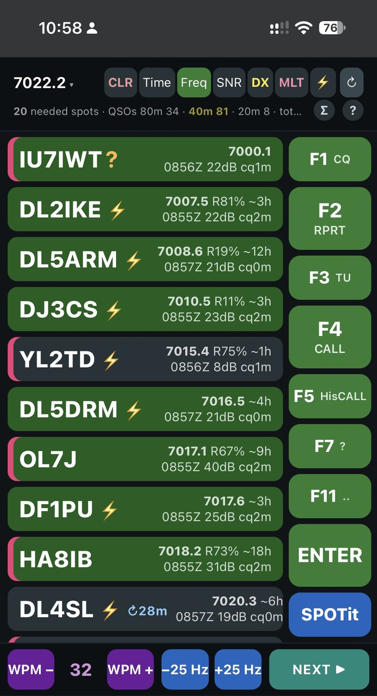
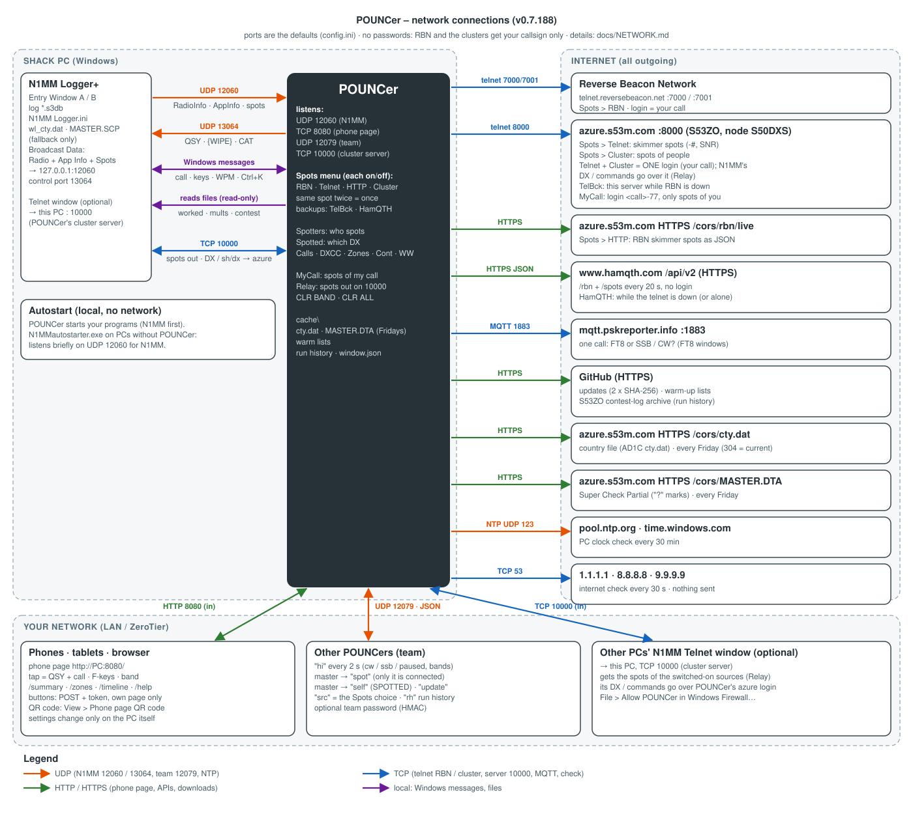
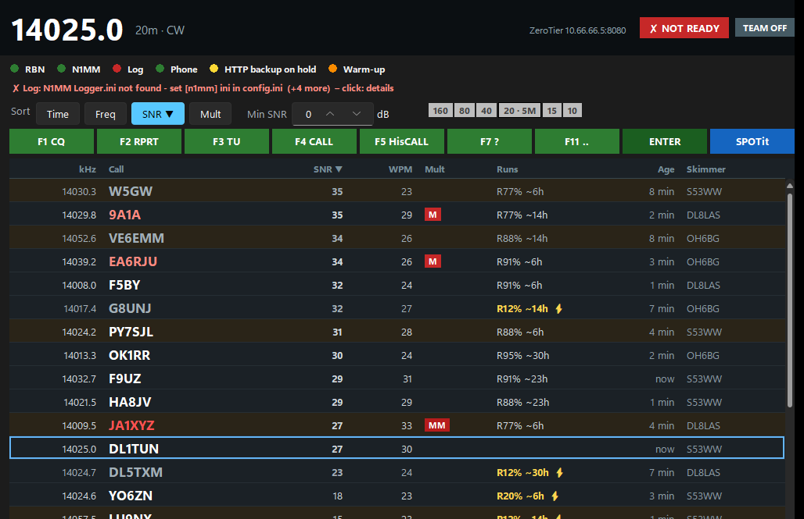
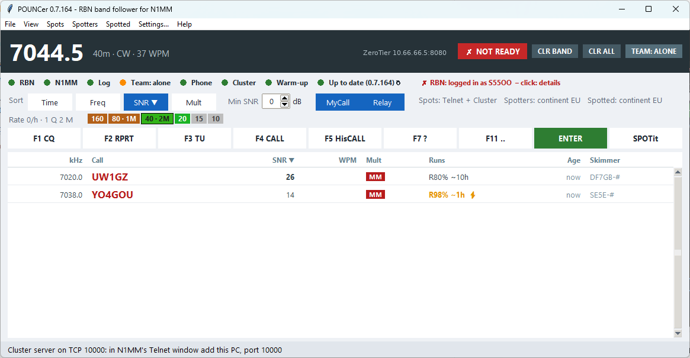
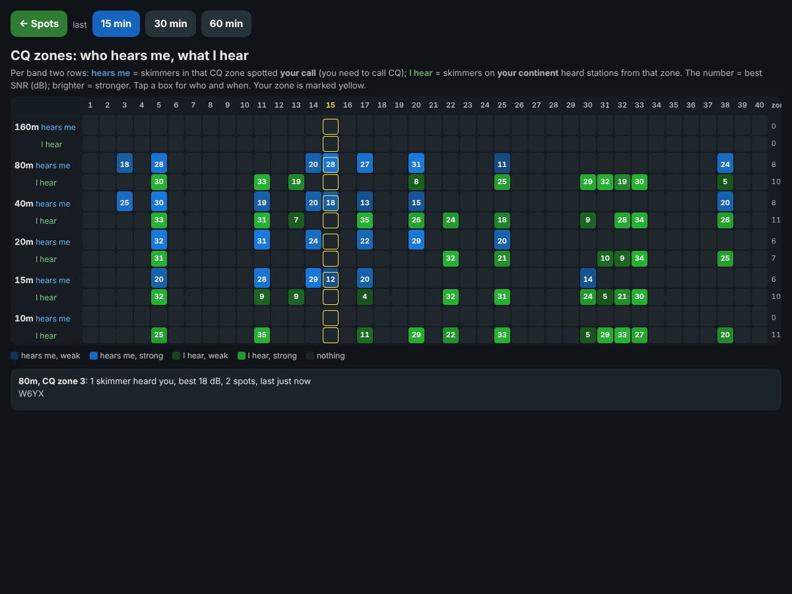
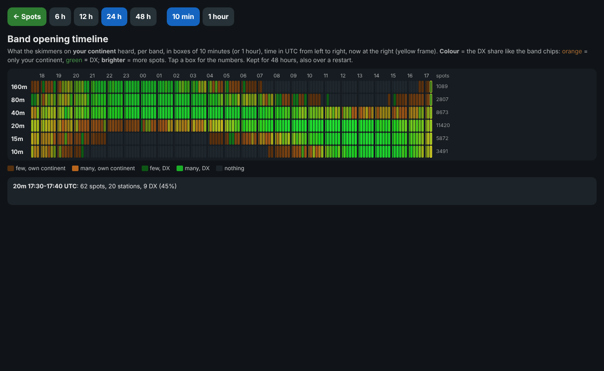

# POUNCer

**Search & pounce helper for N1MM Logger+ contesting.** POUNCer follows the
band your radio is on and shows who is calling CQ there right now - live
**Reverse Beacon Network** spots from a chosen skimmer (default **S53WW**) on
CW, and **DX-cluster** spots on SSB. Each station is marked with what helps you
decide: new multiplier, already worked, and whether it usually runs for hours
or only briefly (from 5 years of contest logs). **One tap** tunes the radio -
radio A or B in SO2R / SO2V - and puts the call into N1MM's Entry Window.
Use it on the PC, or on a phone or tablet next to the radio; several
operators' POUNCers share one feed as a team.

Windows (POUNCer.exe) and macOS; nothing to install - put the exe and
`config.ini` in a folder next to N1MM and start it.

> **New to POUNCer? Read the [one-page overview](docs/OVERVIEW.md) first** -
> what it does, how it works, getting started, and the parts built on
> **S53ZO's** work.

<p align="center"></p>

*The phone page in a contest on 40 m: frequency 7022.2 (tap it for the band
menu, also **ALL bands**), CLR / Time / Freq / SNR / DX / MLT / ⚡ sorting,
needed spots and QSOs per band under it. Tiles sorted by frequency: green =
strong (20 dB+), ⚡ = rare CQ, **?** = not in Super Check Partial, run % and
hours from past logs (R81% ~3h), first heard, SNR and how long it has been
calling (cq2m), pink stripe = new multiplier, ↻28m = you tapped it 28
minutes ago. On the right the default keys: F1 CQ, F2 RPRT, F3 TU, F4 CALL,
F5 HisCALL, F7 ?, F11 .., ENTER and SPOTit (half size: F1, F3, F5, F7, F11,
SPOTit); WPM / ±25 Hz / NEXT at the bottom.*

## How it works

<p align="center"><a href="docs/NETWORK.md"></a></p>

### All network traffic, in and out

Everything POUNCer receives or sends, with the default ports (each can be
changed in `config.ini`). **No passwords anywhere:** RBN and the DX cluster
get your callsign only, and nothing personal is sent. Message formats and
examples: [docs/NETWORK.md](docs/NETWORK.md).

**Coming IN to POUNCer** - the only ports a firewall must let in:

| From | Transport / port | What comes in | When |
|---|---|---|---|
| N1MM Logger+ (same PC) | UDP **12060** | `RadioInfo` (frequency, mode, radio A/B, Entry Window), `AppInfo` (open log + contest, station call), N1MM's cluster `spot`s | all the time (N1MM *Broadcast Data*: Radio, App Info, Spots) |
| Phones, tablets, browsers (LAN / ZeroTier) | TCP **8080** (HTTP) | the phone page and its API: list, tap = QSY + call, F-keys, band, settings (changes only from the PC itself) | while a page is open |
| Other POUNCers (team) | UDP **12079** (broadcast + direct) | `hi` every 2 s, the master's `spot`s, `self` (SPOTTED), `update` (update all), `rh` (run history) | in a team |
| Other POUNCers (team) | TCP **8080** (HTTP) | `GET /api/runhist` when a POUNCer joins the team | once per join |
| N1MM's Telnet window, other cluster clients | TCP **10000** (telnet) | login (a call), `sh/dx`, `bye` - the spots of the switched-on sources go out as `DX de` lines (Relay on); the client's lines go over POUNCer's own telnet connection | only with *Settings > Cluster server* on |

**Going OUT from POUNCer:**

| To | Transport / port | What goes out → what comes back | When |
|---|---|---|---|
| N1MM Logger+ (127.0.0.1) | UDP **13064** | XML commands: QSY radio A/B, `{WIPE}`, CAT strings (filter). Never transmits | on a click / tap, band, ±Hz, filter |
| N1MM's windows (same PC) | Windows messages (no network) | the call into the Entry Window, F-keys, Enter, PgUp/PgDn, Ctrl+K CW text; reads the CW speed box | on a click / key; WPM once a second |
| N1MM's files (same PC) | file read, read-only | the log `.s3db` (+ `-wal`), `N1MM Logger.ini`, `wl_cty.dat`, `MASTER.SCP` | log every 0.5 s, ini every 10 s |
| telnet.reversebeacon.net | TCP **7000** / 7001 (telnet) | login = your callsign → RBN skimmer spots (CW/RTTY; 7001 = FT8/FT4) | while a radio is on CW; team: the master only |
| azure.s53m.com | TCP **8000** (telnet) | RBN backup → the same skimmer spots | when RBN's telnet is down |
| azure.s53m.com | TCP **8000** (telnet) | DX cluster → SSB spots (closed while N1MM sends its own spots) | while a radio is on SSB |
| azure.s53m.com | TCP **8000** (telnet) | login `<call>-77` + `accept/spots call <call>` → spots of **your** call only (SPOTTED pop-up) | always (`[ui] self_spot_alert`); team: the master only |
| azure.s53m.com | HTTPS **443** | `GET /cors/rbn/live` → RBN spots as JSON pages | only while the telnet feeds are down |
| mqtt.pskreporter.info | TCP **1883** (MQTT) | subscribe to one call → its FT8/FT4 reports (is that spot FT8 or SSB?) | only for SSB spots in the 40 m / 160 m FT8 windows and CW spots in an FT8 / FT4 window, max 2 min |
| api.github.com, github.com | HTTPS **443** | update check → new POUNCer.exe (SHA-256 checked); warm-up lists (CW, SSB) | start + every 6 h; lists every 30 days |
| raw.githubusercontent.com | HTTPS **443** | S53ZO's public contest-log archive → run history of a call (the call is in the URL) | for spotted calls not in the lists, cached |
| www.supercheckpartial.com | HTTPS **443** | `MASTER.SCP` (only if newer: 304 otherwise) | at start + every 7 days |
| pool.ntp.org, time.windows.com | UDP **123** (NTP) | one 48-byte time request → the PC clock check | at start + every 30 min |
| api.github.com | HTTPS **443** (`HEAD`) | clock check fallback (its `Date` header) | only if no NTP server answers |
| 1.1.1.1, 8.8.8.8, 9.9.9.9 | TCP **53** | a plain connect, **nothing sent** → the "Internet down" bar | every 30 s (10 s while down) |
| 8.8.8.8 | UDP (connect only) | **no packet** - only asks Windows which network card has the LAN address | at start (phone address) |

Firewall in short: allow **in** UDP 12060 (from N1MM), TCP 8080 (phones,
team) and UDP 12079 (team); everything else is outgoing.

* **Own call** - taken from the open N1MM log's *Change Your Station Data*
  (follows the log you open); your own spots are never listed, and EU/DX
  colouring is from that call's continent.
* **RBN** - a telnet client connects to `telnet.reversebeacon.net:7000`, logs in
  with your callsign (from N1MM unless `[rbn] callsign` is set), and keeps only the spots whose spotting node matches the
  configured `spotter` (e.g. `S53WW`). By default it is **CW only**; the
  `[rbn] follow_modes` option can additionally show RTTY (port 7000) and
  FT8/FT4 (port 7001).
* **N1MM radio info** - N1MM broadcasts an XML `<RadioInfo>` packet on UDP port
  **12060**. POUNCer reads the frequency/mode from it and uses the band to
  filter the spots it displays.
* **N1MM control** - clicking a spot sends XML to UDP port **13064**:
  * `<radio_setfrequency>` to QSY the radio.
* **Callsign entry** - the callsign is typed with simulated keystrokes
  (`SendInput`) into the focused N1MM Entry Window (Alt+W to wipe, then the
  characters). No N1MM transmit command is ever sent, so the callsign is never
  sent over the air. The `[n1mm] focus_n1mm` option brings the Entry Window to
  the foreground first so the keystrokes land in the callsign box.
* **EU / DX** - each spotted call is looked up in N1MM's own country file
  (`SupportFiles\wl_cty.dat`). Stations outside your continent (EU for S5)
  are DX: their callsign is **yellow** on the phone page
  (EU calls white), plus a **Cont** column and light-orange rows in the main
  window.
* **Worked calls** - N1MM logs are SQLite (`.s3db`) files, and each file can
  hold many contests. POUNCer opens the database N1MM currently has open
  (read-only, auto-detected from `N1MM Logger.ini`) and considers **only the
  contest N1MM has open** (`Contest NR=` in the ini), so QSOs from other
  contests are not treated as worked. Spots whose callsign is already worked on
  the **same band and mode** are hidden - as soon as you log the QSO (POUNCer
  watches the log's `-wal` / `-shm` files through open handles, and N1MM's
  *Contacts* broadcast if ticked, and reads a fresh copy of the log -
  v0.7.169 / 0.7.170 fixed a worked station staying in the list on Windows). The status line also shows how many
  QSOs the open contest has per band (the band you are on is highlighted) and
  the total. The log is re-read every few seconds -
  and whenever you switch contests - so changes take effect quickly.
* **No log open** - if N1MM Logger+ is not running, its ini names no log, or the
  named `.s3db` is missing, the phone page shows an orange **"open a log in
  N1MM"** banner (and the main window says so in its Log line). Spots are still
  shown, but nothing can be hidden as worked. POUNCer looks again every 2 s, so
  the banner clears on its own once you open a log; the **Reconnect** button
  (banner, the **Log** button next to Sort, or *File > Reconnect log* in the
  main window) re-reads which log N1MM has open immediately.
* **Touch / big-button view** - the phone page in your PC's default browser
  (touch screen, second monitor): *View > Phone page in the browser* in the
  main window opens it (or set `[ui] touch_view = true` to open it at startup).
  The old separate Tk touch window is gone - one view for everything.
* **Phone view (web)** - a small local web server (stdlib only) serves the same
  needed spots as big tap tiles for a phone/browser. Tapping a tile QSYs and
  enters the call on this PC. Open
  `http://<pc-ip>:8080` - the exact address is shown in the top bar next to
  the frequency and on the **Phone view** line of the main window: the ZeroTier address if ZeroTier is running, otherwise the
  LAN address, plus the port it listens on. **Easier: a QR code** - click
  that address in the top bar (or *View > Phone page QR code…*): a window with
  one QR code per address (**LAN**, and **ZeroTier** when this PC is on
  ZeroTier). Scan it with the phone's camera and the page opens, no typing.
  Click a code to open the page in this PC's browser; Esc closes.
  Binds to all interfaces, so it works over your LAN and over ZeroTier/VPN for
  remote access. LAN/VPN only, no password (see *Security*). **Sort: Time / Freq / SNR** buttons (**CLR** in front clears all spots, with Undo)
  in the top header row reorder the tiles (the choice is remembered in the
  browser); the **DX** button next to them puts DX spots on top, still in that
  order, and **MLT** puts new multipliers on top (double, then single; magenta
  bar on the tile - thick = double). The station your radio is tuned to
  (within 0.5 kHz) has a light-blue outline. **Hold a tile for 2 s** for a box with
  **Remove** (that call off the list, with Undo) and **Debug** (below); the station you tapped keeps a yellow
  border until you tap another. The **footer** has **WPM − / WPM +** on the
  left (N1MM PgDn / PgUp = CW speed) and **−25 Hz / +25 Hz** in the middle
  (move the VFO via N1MM; step = `[ui] tune_step_hz`), and **NEXT ▶** on
  the right: the next station of the list in the order shown (after the one
  you tapped last; at the end it starts again at the top) - QSY and call,
  like tapping its tile. None of them transmit.
  The **?** at the end of the status line opens a help page explaining
  every button.
  **cq3m** on a tile = how long that station has been calling on that
  frequency (from the RBN spots, live).
  **Run history:** each tile shows `R81% ~23h` = how often that station ran
  (called CQ) and how many hours it was on the air in its logs of the last 6 years of
  the same contest (else its other contests in that mode), from S53ZO's public contest-log archive (`*` = reconstructed log,
  for stations that never sent one). The **R%** is for the **spot's band**
  when its logs have enough QSOs there (a 20 m runner that only S&Ps on 80 m
  shows its 80 m habit on an 80 m spot), else over all bands. Logs written
  without CAT (no real frequencies) still give the **hours**, just no R%; **⚡** = rare CQ (runs under 30% or on
  under 6 h) - it won't last, work it now
  (`[ui] run_history`, cached in a `cache` folder). The **⚡** header button
  sorts the rarely-running stations to the top. A new call is known in about
  a second (8 looked up at a time; instant once cached).
  **Warm-up:** at start POUNCer downloads (once, refreshed after 30 days)
  ready lists: **CW** - about 46 000 stations from CQWW CW, ARRL DX CW and
  CQ WPX CW - and, **separately, SSB** - the same contests' phone versions
  (CQWW SSB, ARRL DX SSB, CQ WPX SSB, about 61 000 stations), since who runs and for how long is
  different on SSB. Last 5 years, submitted + reconstructed logs, so the
  marks are there the moment a call is spotted; an SSB spot gets the SSB
  numbers (`[ui] warmup`; built by `server/warmlist.py`, release `warmup`).
  Stored as `cache\warm.sqlite` and `cache\warm-ssb.sqlite`;
  `cache\warm-up.txt` / `warm-up-ssb.txt` and the main window say when
  they were downloaded. QSOs logged without CAT (only the band edge, e.g.
  28000) don't count as running.
  Calls not in it are looked up live.
  Or put a ready-made **`runlist.sqlite`** next to `config.ini`
  (`[ui] run_list`) - loads at start, no download.
  Or with the optional **run list server** (`server/`, Docker, e.g. on ZeroTier;
  `[ui] run_server`) the whole CQWW list is loaded at start, so the marks
  are there the moment a call is spotted. See `server/README.md`.
  Confirmations ("Wide filter", "CW faster", Undo after a remove) pop up at
  the top, just under the header, for 5 s (tap to close). On a phone the tiles are compact one-line rows (callsign left,
  details right) so about 10 fit on screen; wider screens get two columns of
  big tiles. The TX/log key buttons sit in a column on the right of the list
  (full keys such as F2, F4 and ENTER are about 1.3 spot rows tall - room for more keys - half keys one row); they are green and turn red when
  pressed.
  The header shows the radio frequency; **tap it to pick a band** (160, 80,
  40, 20, 15, 10 m): the list then shows **that band's spots** - the radio
  stays where it is until you **tap a station** there, which QSYs it as
  usual. "15m list · on 20m ✕" in the small line (tap it to go back to the
  radio's band); once the radio changes band the list follows it again.
* **TX / log buttons** - the main window and the phone page all
  show buttons for `[ui] fkeys` (default `F1:CQ F2:RPRT F3:TU F4:CALL F5:HisCALL F7:? F11:.. Enter SpotIt:SPOTit`; on the phone F1 + F3 (at the top) and F5, F7, F11 are half as tall and share one key's place each, SPOTit is half size under ENTER, `[ui] fkeys_half`; both in *Settings > Program*; a list an older POUNCer wrote unchanged is read as the new default; **SPOTit** = N1MM's Spot It, Alt+P: it spots the Entry Window call to the cluster, no TX). An F-key
  button presses that function key in the focused N1MM Entry Window, so N1MM
  sends its message - e.g. F4 normally sends `{MYCALL}`. Unlike tapping a spot,
  **F-keys transmit over the air**. The `Enter` button logs the current QSO in
  N1MM (no transmission). N1MM's documented way to do this from another program
  is to send the keystroke to the Entry Window (`EntryWindowHwnd`). Reorder or
  disable the buttons with e.g. `fkeys = F1:CQ F4:MyCall Enter` (empty = no
  buttons).
* **Control N1MM** (phone band menu - tap the frequency) - **off** on every
  phone until you switch it on there once (remembered per phone): **look
  only**, tapping a station, NEXT, F-keys, ENTER, Spot It, CW keyboard, tune
  and CW speed do nothing (keys dimmed). On the PC, *Settings > Tap -> N1MM >
  Phones may control N1MM* (`[web] phone_control`): **phone** = each phone's
  own switch, **all** = every phone at once (no switch needed), **off** = no
  phone or other PC can (POUNCer refuses it, HTTP 403). In a team the
  **master's** choice counts for all POUNCers. The browser on the PC itself
  always can.
* **Keyboard F-keys** - with the POUNCer window active, F1-F12 (and Enter,
  if it is one of the set keys) go straight to N1MM: POUNCer focuses the
  Entry Window and presses the key there, so the message is sent
  (`[ui] forward_fkeys`).

Only the Python standard library is used (tkinter for the GUI). No pip install
is required.

## Everything at a glance

**Spots and tapping**
- RBN skimmer spots (CW; default S53WW, or **several skimmers and whole CQ
  zones** together, `TK0C, IT9ABC, ZONE15`; backup skimmers / RBN over HTTP
  when quiet) and SSB spots - **from N1MM's own cluster spots** (Broadcast
  Data > Spots), POUNCer's own DX-cluster connection only as a backup - for
  the band your radio is on.
- No RBN when it isn't needed: an **SSB contest** open in N1MM, or every
  radio on SSB - also for the **whole team** (each POUNCer says whether it
  needs RBN).
- Marks: new multiplier (single / double), worked, ⚡ rare CQ (from 5 years
  of logs), ? busted call (Super Check Partial), ↻ already tried, strong,
  ★ heard by your own skimmer (with several listed).
- **Tap** (phone) or **click** (window) = QSY + call into N1MM, no TX. The
  phone then says what really happened (✓ radio on 7012.0 · call in; ⏳
  waiting for N1MM when its report is slow, then ✓ "reported it late" or ⚠
  "never reported - check the radio"). A slow N1MM is handled: no report in
  2.5 s → the QSY is sent once more; the call is kept in the box and put
  back if N1MM's late QSY wipes it (only into an empty box, never over your
  typing). The tapped station **keeps its place** until logged or 60 s.
- Band menu / band chips: look at another band without moving the radio;
  **ALL bands** on the phone = every band on one list (hunting new mults).
- Minimum SNR, DX / MLT / ⚡ first, calm list, NEXT, CLR with undo.
- **Alert** when a rare CQ (⚡) that is also a new mult appears: **pop-up**
  and **sound** switched on their own (window: View menu; phone: band menu);
  click the window's pop-up = QSY and call.
- **SPOTTED pop-up**: someone spotted your call on a DX cluster ("SPOTTED:
  S55OO by DL1ABC on 14025.0"; skimmers don't count, a self-spot shows marked).
- Window list: the **table in small fonts** (default) or tiles like the phone
  (Ctrl+T); looks Dark / Light (Windows 11 style) / Classic, sharp at 125 /
  150 % scaling.
- **Compact window** beside N1MM (Ctrl+M): A / B, frequencies, small band
  chips, the list; ⤢ = back to the full window.

**Keys** - F1 ... F7 (transmit), ENTER (log; hold 1.3 s = CW keyboard),
**F11**, **SPOTit** (N1MM Alt+P, spot to the cluster), WPM − / +, −/+ 25 Hz;
half-size keys on the phone (F1 + F3, F5, F7, F11, SPOTit); full keys are compact too, so more keys fit. Order and sizes in
*Settings > Program*.

**Pictures of the band**
- Band chips: DX heard, DX share colour, **new mults waiting** per band.
- **CQ zones**: who hears you / what you hear, per band and zone 1-40 - a
  window of its own (View menu) or the phone / browser page.
- **Band opening timeline**: spots per band in 10-minute boxes, 48 h - a
  window or the page.
- **Contest summary**: QSOs, from POUNCer, mults, rate, best 60 min.
- **Rate line** in the window: rate (10 min / hour), QSOs and mults per band.

**Station** - SO2R / SO2V (radio A / B, per phone), team of POUNCers on the
LAN (one RBN feed for all), pre-contest check (READY / CHECK, each item in
its own colour; **skimmer offline** warning), stream lights (green working,
yellow on hold, red problem), **station test** (QSY + callsign per radio),
CW speed popup, autostart of your other programs (**N1MM first**,
then the rest when N1MM is up; 8 programs, each optionally "only when N1MM is
up"), auto-update from GitHub.

**When something is wrong** - a **red line** at the bottom of the window
says what failed (the refresh, a button, reading the N1MM log), when and
how often; click it to open pouncer.log (v0.7.176). `cache\pouncer.log`, *Help > Save
diagnostics* (zip, no passwords), `cache\perf.csv` (CPU / memory / disk of
POUNCer, N1MM and Windows, a row a minute), **traffic console** (View menu,
Ctrl+Shift+D: the raw data of every source, only while open), phone *Reset
this page*.

Every symbol and colour: [docs/SYMBOLS.md](docs/SYMBOLS.md) · network
connections: [docs/NETWORK.md](docs/NETWORK.md) · code:
[ARCHITECTURE.md](ARCHITECTURE.md) · changes: [CHANGELOG.md](CHANGELOG.md).

## Main window menu

<p align="center"></p>

*The Windows main window (0.7.135, clean layout, dark look, made-up spots):
the call big, new multipliers red with an M / MM tag, ⚡ = a rare runner,
DX rows tinted, the station the radio is on framed in blue.*

<p align="center"></p>

*On the air (0.7.164, light look, the address replaced by an example):*
- *menu bar:* **Spots** (RBN / Telnet / HTTP / Cluster, TelBck, HamQTH),
  **Spotters** (who spots), **Spotted** (who is spotted);
- *top bar:* frequency, band, mode and N1MM's CW speed; the phone-page
  address; **CLR BAND** / **CLR ALL**; the team badge;
- *first row:* Sort, Min SNR, **MyCall | Relay**, then the line saying what
  is in use - here *Spots: Telnet + Cluster, Spotters: continent EU,
  Spotted: continent EU* (click = every connection and its state);
- *the list:* skimmer spots from the Telnet source (azure) with their SNR
  (26, 14 dB) - both new multipliers on two bands (MM), one a rare runner
  (⚡); the status line says the cluster server is waiting for N1MM on TCP
  10000.

The window has two layouts (*View > Detailed layout*, `[ui] layout`).

**Clean** (the default since v0.7.135) - the spots first:

- a **dark top bar**: the radio frequency **large**, then band · mode · CW
  speed (and the other radio in SO2R / SO2V); on the right this PC's
  address with the phone page's port - **ZeroTier 10.66.66.5:8080**, or
  **LAN 192.168.1.20:8080** without ZeroTier (click: the QR codes for the phone) - the
  **READY / CHECK / NOT READY** badge and the team badge;
- **one row of lights** - only the connections that are on (a light that is
  simply off isn't shown) - and, when something is wrong, **one sentence**
  after them: *"✗ Log: N1MM Logger.ini not found (+1 more) – click: details"*.
  A click on it (or on the badge) shows every check item; click again to hide;
- **CLR BAND** / **CLR ALL** in the top bar, next to the team badge: forget
  the spots of the band in the list (the radio's, or the band chip clicked) /
  of every band.
- **one row of controls**: Sort (Time / Freq / SNR / Mult), Min SNR,
  **MyCall | Relay** (every button the same width, room for six letters),
  then one short line **"Spots: RBN + Cluster   Spotters: S53WW"** - what is
  in use (click = every connection and its state). Where the spots come
  from and which spotters: the menus **Spots** and **Spotters** (see *Spots:
  where they come in from*; in a team the master's choice, a slave's click
  asks the master). Then the
  **band chips** (`20 · 7M` = 7 new mults spotted on 20 m; colour = band
  open; click = list that band) and the **rate** (`Rate 84/h · 1234 Q 345 M`);
- the F-keys (ENTER green);
- the **spot list as readable rows**: the **call big and bold**, the rest small
  and quiet; colour only where it means something - **new mult**: the call
  red and an **M / MM** tag; **worked**: the row grey; **DX**: a warm row tint;
  the station the radio is on: a blue frame; **Runs** `R84% ~23h` (⚡ yellow =
  rare runner; **hover over it** for what it means for that station);
  **Age** = since its last spot. *Mode* and *Type* appear only
  when the list has more than one mode or a spot that isn't a CQ. Click a
  heading to sort (not WPM); click a row (or arrows + Space) to QSY and call;
- a status bar: what the last tap did.

**Detailed** - everything as before v0.7.135: the check items whenever
something is wrong, the lights with *Band open* chips, the rate line, the
N1MM / RBN / Log info lines, the table with every column, and the phone
address in the status bar. The compact window (Ctrl+M) and the tiles
(Ctrl+T) work in both.

The options and actions are in the menu bar (sort, the A / B key and the
F-keys stay as buttons - they're used all contest long):

* **File** - open the config folder (Explorer), Reconnect log, Start
  autostart programs now, Don't wait for N1MM (start the rest now), Open the
  autostart folder, Restart POUNCer, Exit.
* **View** - *Also enter callsign in N1MM* and *Hide worked* (tick),
  **Compact window (beside N1MM)** (tick, **Ctrl+M**) and **Always on top**
  (tick), **Alert pop-up (rare CQ + new mult)** and **Alert sound** (tick),
  **Detailed layout** (tick: every status line and the old table),
  **Rate / QSOs / mults per band line** and **Spot list as tiles** (Ctrl+T)
  (tick), Clear spots, Contest summary, **CQ zones: who hears me** and **Band
  opening timeline** (each opens a window of its own), Phone page in the
  browser / as an app window, **Traffic console** (Ctrl+Shift+D), **Station
  test**, Look (Dark / Light / Classic).
* **Settings...** - the settings window (below).
* **Help** - what every button does, check for a new version, POUNCer on
  GitHub, **Save diagnostics (zip)**, **Open the log file**, **Open the
  performance log**, About.

**Look** (View > Look, from the next start; `[ui] look`): **Dark** (the
default: Windows 11 style in the phone page's colours, dark title bar, flat
green F-keys / ENTER and a blue SPOTit like the phone), **Light** (the same
Windows 11 style, light) or **Classic** (the look up to v0.7.92). POUNCer
draws **sharp at 125 / 150 % display scaling** (it tells Windows it handles
the scaling; the saved window size is converted once).

The window's spot list is the **table in small fonts** (default, as up to
v0.7.92); the phone page keeps its tiles.

**Spot list as tiles** (View menu or **Ctrl+T**, `[ui] spot_tiles`, off by
default): the spots as cards like the phone - the call big (yellow = DX,
grey = worked, ⚡ rare CQ, ? not in SCP, ↻ tapped), frequency / run history
over first heard / SNR / calling time; green = strong, darker = not
re-spotted lately, pink bar = new mult (thick = double), blue frame = the
radio is on it, yellow frame = selected. Click = QSY and call; arrow keys
move, Space taps. Off = the table with columns (sorting by a column heading).

**Rate line** (under the lights, `[ui] rate_line`, View menu): the rate of
the last 10 minutes (as QSOs/h) and of the last hour, QSOs and multipliers in
total and per band, "+n" = new this hour - from the open N1MM log, every
30 s.

**Internet down** (`[ui] internet_check`): every 30 s POUNCer tries a plain
connect to 1.1.1.1 / 8.8.8.8 / 9.9.9.9 (port 53, nothing sent). No answer
twice: a **red bar "⚠ Internet down since 12:03 (14 min)"** under the top bar
(and on the phone). The spots you had stay in the list **greyed out** instead
of ageing out (spots from the team master or N1MM still come in colour), so
you still see who was where. POUNCer reconnects by itself, quietly (a
connection error is logged once, then every 10th try); when the internet is
back - "✔ Internet back after 14 min" for 8 s - every feed reconnects at once
instead of after its backoff of up to a minute, and old spots age out
normally again.

**SPOTTED pop-up** (`[ui] self_spot_alert`; also a yellow bar in the window
under the top bar, for 3 s): when your call (the log's
station call - S55OO, TK0C ...) is spotted on a DX cluster by a person (not a
skimmer -#), a pop-up like the multiplier alert says "SPOTTED: S55OO by
DL1ABC on 14025.0" (with the alert sound, if on). Your own self-spot shows too,
marked "(self-spot)". *Your call* = N1MM's station call (`<mycall>` in its
radio info, Config > Change Your Station Data), else the open log's, else
N1MM's ini - so with a TK0C log open it is TK0C. **N1MM never passes on spots
of your own call** (not
even when someone else spots you), so POUNCer keeps a small cluster
connection of its own just for them: `[ssb] self_spot_host` (default
azure.s53m.com:8000, the node N1MM uses), login `<call>-77` (`self_spot_ssid`:
its own SSID, never N1MM's; in a team only the master logs in and passes
spots of your call on to the others), and after login `self_spot_filter` (`accept/spots call
{call}`) tells the node to send **only spots of your call** - normally not a
single line arrives on it. Shown as "self-spot" (TELNET) in the traffic console.
Spots of your call from POUNCer's Cluster source or the team master count
too. In a team every PC gets it, but the **pop-up only shows on the PC whose
radio is on the spot's band** (`[ui] self_spot_band_only`, on); the others log
it and show it in the status line (no radio info yet: pop-up anyway).
Every spot of your call is written to
the log ("spot of my call: ..."), so `cache\pouncer.log` shows whether it
arrived at all.

**Station test** (View > Station test): per radio a QSY 0.1 kHz up and back
(no TX) with N1MM's response time, then a test call into the empty callsign
box of its Entry Window, read back and cleared (a box that holds something
is left alone). A quick check after setting up - cables, COM ports,
Broadcast Data.

**Phone page as an app window** (View menu): the phone page on the PC in a
window of its own - Edge or Chrome "app" mode, no tabs, no address bar.

**Traffic console** (View menu or **Ctrl+Shift+D**): the raw data of every
source as it arrives or goes out - RBN lines, **TELNET** (*Spots: Telnet*,
the telnet server's skimmer spots, and the spots-of-my-call connection -
both azure.s53m.com:8000), **SSB** (*Spots: Cluster*, the cluster's spots of
people, and the commands sent), N1MM UDP packets in and QSY / call commands
out, the HTTP feed, the team, the cluster server (**SERVER**), FT8 / FT4
spots kept out of port 10000 (**FT8**), beacon spots kept out (**BEACON**: the NCDXF beacons on their frequencies, /B calls), the phone page's requests (WEB, off
at first). Tick sources on / off - **None** unticks them all, to then tick
only the one to watch (**All** ticks them back) - type a filter word (a call, `DX de`, `RadioInfo` ...),
Pause, Clear; outgoing lines are yellow (`>`). **Hover over a source** (its
switch or its dot): a pop-up says what that source is and what POUNCer is
monitoring with which settings right now - server and port, login call,
mode, filters, listen address, team role and peers, Relay on / off (a team
password only as "set" / "off", never the key) - plus why it is quiet and
how many lines came. Under the switches each
source has a **dot**: green = lines now, amber = quiet 5 s+, red = quiet
30 s+, grey = quiet for a known reason; next to it how many lines came,
"hidden", how long it has been quiet and why (RBN paused - every radio on SSB, SSB spots come from N1MM, via the
team master ...), so a quiet source doesn't look like a stuck console;
switching a source off / on leaves a marker line in the view; **Reset
counters** sets the counts to 0. Scrolled up,
a blue bar says how many **new lines are below** - click it to follow
again. An error while showing a line is written into the view and the
console goes on. The taps only
work while the console is open - closed, it costs nothing.

The spot list (table): **new multiplier** rows in bold red, **worked** ones in grey
(when *Hide worked* is off), **⚡** before the call = rare CQ, **?** after it
= not in Super Check Partial; tuned to it = blue, DX = orange background.
**Arrow keys** move through the list, **Space** taps the selected spot (QSY
and call, like a click); the selection stays put while the list updates.

**Compact window** (View menu or **Ctrl+M**): a narrow window (330 × 430)
that stays on top beside N1MM's Entry Windows - one line with the **Radio
A / B** button and both radios' frequencies (and WPM), a row of **small band
chips** (colour = band open like the big chips, `40·3` = 3 new mults spotted
on 40 m, frame = the radio's band; click one = list that band, ▶ = shown),
then the spot list with just frequency, call (⚡ / ?) and mult. Clicks, arrow
keys and Space work as always. **⤢** (right of the frequencies), Ctrl+M or
unticking it brings the full window back at its old size. The compact size
and position are remembered separately; *Always on top* also works on its
own. Want only what you still need? Tick *Hide worked* too.

**Alert** (View menu, window): when a **rare CQ (⚡) that is also a new
multiplier** appears in the list - once per station and band, not for what
is listed in the first 30 s after the start:

- **Alert pop-up** (on by default): a yellow pop-up at the top of the window
  for 8 s, `⚡ rare CQ + new mult: 3B8X 7012.0`; **click it = QSY and call**,
  like clicking the spot. It never takes the keyboard from N1MM.
- **Alert sound** (off by default): two short beeps.

Each on its own - the pop-up without the beep, or the beep only. Saved in
`config.ini` (`[ui] alert_popup`, `alert_sound`). The phone page has its own
two switches (band menu), so a phone can beep while the PC stays quiet.

**Min SNR** (next to the sort buttons; on the phone **hold the SNR key 1.3 s** -
a short tap still sorts by SNR; when on, the key shows a small ≥10):
spots weaker than that are not listed, in the window and on the phone -
one setting (`[ui] min_snr`; **default 0 = off, all spots listed** - raise it
only when a busy band needs it). New multipliers and SSB cluster
spots (no SNR) are always listed; the window's RBN line and the phone's
top line ("+5 weak") say how many are hidden.

**Band open lights** (window: a row under the lights; phone: a dot on each
band in the band menu): per contest band, what the skimmers on **your
continent** heard in the last 10 minutes (the whole RBN feed) -
**20m: 34 DX 85%** = 34 different DX stations, 85 % of all heard. The colour
goes with that share: orange = (almost) only your own continent, through
yellow, to green = (almost) all DX; **80m: EU only** = no DX to speak of;
grey **160m: –** = nothing. **· 6 mults** = 6 stations spotted on that band
right now would be a new multiplier there (the spots in the list, same
modes; phone: a pink **6M** on the band) - which band next, at a glance.
**Click a chip** to see that band's spots in the
list (the radio stays; ▶ marks it) - click a spot to QSY there, or the chip
again to go back to the radio's band. A team slave shows the master's
counts. `[ui] band_lights = false` hides them.

**Already tried**: stations you tapped (called) get **↻3m** after the call
(window and phone) = last tapped 3 minutes ago on this band, **×2** = twice,
for 30 minutes (`[ui] mark_tried`, `tried_minutes`; Settings).

**Pre-contest check line** (top of the window): **READY** / **CHECK** /
**NOT READY** with ✓ / ⚠ / ✗ for N1MM radio info, log, station call, RBN,
country file (⚠ > 60 days old), Super Check Partial (⚠ > 30 days), phone
page and PC clock (checked against an NTP time server every 30 min). Each item
has its own colour: **red** = not working, **amber** = check it, **green** = OK
(N1MM closed: N1MM red, RBN / SCP still green). The phone
shows ⚠ in its top line only when something is wrong; tap it for details.
`[ui] check_line = false` hides it.

**CW speed**: POUNCer reads N1MM's keyer speed from the speed box of each
Entry Window (A and B) once a second and shows it in the N1MM line
(`CW 28 WPM`), the compact bar and on the phone between WPM − and WPM +.
When the speed changes - from the WPM buttons, PgUp / PgDn in N1MM or
anything else - a short **CW 30 WPM ▲** popup shows the new speed (it
never takes the keyboard from N1MM). If the speed doesn't show, send
`cache\cwspeed.txt` - it lists what POUNCer found in the Entry Window.

The window remembers its size and position (maximised too), the column
widths and the sort for the next start (`cache\window.json`; delete it to
start with the defaults). A position on a monitor that is no longer there
is moved back onto the screen.

## Connection lights (Windows window)

Every mark, colour and badge of the window and the phone page is explained
in **[docs/SYMBOLS.md](docs/SYMBOLS.md)**.

Under the MASTER / SLAVE bar a row of lights shows at a glance that
everything is connected:

Green = this stream works, **yellow = on hold** (ready, just not needed
now), amber = connecting, red = connection problem, grey = off.

| Light | Green | Yellow (on hold) | Amber | Red | Grey |
|---|---|---|---|---|---|
| RBN | skimmer spots coming - from RBN or Telnet (slave: via master; "RBN via HTTP" with only HTTP on) | SSB contest / every radio on SSB | connecting | disconnected | no skimmer source on |
| Cluster | logged in, its spots of people used | N1MM's spots used instead (N1MM on the cluster itself) | connecting | disconnected | *Spots: Cluster* off |
| HTTP | the HTTP feed delivers | - | starting | running, nothing comes | *Spots: HTTP* off / no URL / team slave |
| N1MM spots | used for Cluster (own connection closed) | N1MM sends, own cluster still kept (a minute after a fallback) | - | stopped (20 s+) | Broadcast Data > Spots not ticked / off |

| Light | Green | Amber | Red | Grey |
|---|---|---|---|---|
| N1MM | radio info coming in | none for 2 min | never received | - |
| Log | contest log open | checking | no log / N1MM not running | - |
| Team | master or slave (count) | alone on the network, or a team POUNCer runs another version (says which IP / version) | - | team off |
| Phone | web view running | - | port in use | disabled |
| Warm-up | list loaded | downloading | download failed | off |
| Update | up to date | checking / check failed | - | off (blue = new version ready: **Restart** button) |

**Auto-update:** click the **Update** light ("Up to date (…) ↻") to check
GitHub right now - a new version is downloaded, then click it again (or
**Restart**) to start it. Otherwise the exe checks GitHub at start and every 6 h; a newer
release is downloaded, its SHA-256 checked, and it replaces POUNCer.exe on
disk. It runs from the next start (or press **Restart -> vX**); POUNCer
never restarts by itself in the middle of a contest. `[ui] auto_update`.

**Update the whole team (from the master):** *Help > Update all POUNCers in
the team* - only on the team master. Every POUNCer in the team (v0.7.127 or
newer) checks GitHub, downloads the newest version and restarts into it by
itself; the master does the same. A slave says "Only the team master…".

**Kept versions / going back:** each update keeps the exe it replaces in
`versions\POUNCer-<version>.exe` next to POUNCer.exe (the last 3).
*Help > Go back to the previous version* installs the newest kept one and
restarts. The first copy appears with the first update after v0.7.127.

**Switch version…** (*Help*, v0.7.140): the published versions, newest
first; pick any one - newer or older - and POUNCer installs it (checked like
an update), keeps the running one in `versions\` and restarts.

**Two checksums** (v0.7.140): every release has a `SHA256SUMS.txt`; an update
or a switch is installed only if GitHub's own record of POUNCer.exe and
`SHA256SUMS.txt` **agree with each other and with the downloaded file**.
Older releases without that file are checked against the one checksum they
have.

## Windows Firewall and team password

**File > Allow POUNCer in Windows Firewall…** adds the inbound rules
`POUNCer phone page TCP` (TCP 8080, phones) and `POUNCer team UDP` (UDP
12079, the team) on **private and domain** networks - Windows asks for
administrator rights; older rules with the same names are replaced. POUNCer
checks at start whether they are there: then the menu item reads **Windows
Firewall: POUNCer allowed ✔** (click it to add them again, e.g. after a port
change). The rules don't apply to networks Windows calls **Public** - set
the LAN / VPN adapter to **Private**.

When the team should be there (`[team] peers` set, or another POUNCer was
heard earlier) but none is heard for 30 s, the check line says
**Team: no other POUNCer heard – firewall?** (rules missing) or **– check
that PC's POUNCer and its firewall**.

**File > Team password…** (optional): typed twice, the same on every POUNCer
of the team. Every team message then carries a time stamp and an
**HMAC-SHA256** signature; messages without one, with another password,
changed on the way, or **older than 5 minutes** (a recorded message played
back) are ignored - so nobody else on the network can pretend to be the
master. The PC clocks must agree within 5 minutes (the clock check shows
it). Only a key made from the password is stored (`[team] key`), never the
password. The check line names what is ignored (`10.0.0.3: wrong team
password - ignored`), and a POUNCer without the password says when the
others use one. Empty = off (the default). Same scheme as N1MMPingPong's
network password.

## Two radios (SO2R / SO2V)

When N1MM runs two radios (it then has Entry Windows **A** and **B**), the
phone page shows an **A / B** key in the top row, next to the frequency
(CLR-sized; A blue, B orange). It
chooses which radio that phone works: taps (QSY + callsign), F-keys,
ENTER, −/+ Hz and the band menu go to that radio's Entry Window, and the
spot list follows that radio's band. Every phone keeps its own choice -
e.g. one phone for radio A, a second one for radio B. In the main window
the **Radio A (A/B)** badge (in the lights row, after Update; blue = A, orange = B) does the same for clicks and keyboard F-keys;
it only shows while N1MM reports two radios (with one there is nothing to
switch). A phone / browser that had radio B chosen goes back to A by
itself when N1MM reports only one radio again (since v0.7.66).
`[n1mm] default_radio = A` / `B` sets the start radio. Radio B is
QSYed with N1MM's UDP command for radio 2 with mouse button **Left**,
nothing typed (`[n1mm] radio_b_qsy = udp-left`, as SP_Helper does; with
"Right", as N1MM's docs say, it moved radio A on an SO2V). Fallbacks:
`type` = the frequency typed + Enter into Entry Window B, `udp` = the UDP
command with Right. Either way the call then goes into Entry Window B
after N1MM reports the new frequency. After a tap
for the other radio the cursor goes back to where it was - same Entry
Window, same box (callsign / exchange) and cursor position
(`[n1mm] return_focus = true`). Or, with **After radio B: focus back to
A** (`[n1mm] focus_back_to_a = true`, Settings page), every tap or -/+ for
radio B ends with the cursor in Entry Window A, wherever it was - you keep
running on A while B pounces. With one radio
nothing changes. The frequency in the top row then shows **both radios** -
A with B under it; the radio this phone works is the big one. Tapping it
opens one band menu (160-10 m) for the radio chosen with the **A / B** key:
with A it shows that band's spots for radio A, with B for radio B (green =
the band shown, blue ring = the band the radio is on). Tap a station there
and that radio goes to it.

**ALL bands** (the wide key under the bands): **every contest band on one
list** - handy when hunting new multipliers: press **MLT** and the new mults
of all bands are on top (up to 120 spots, new mults first). The pink number
on the key = new mults spotted on all bands. Tap a station: the radio goes
to it (and to its band) and the list **stays on ALL**; tap the *ALL bands
list* tag in the small line to go back to the radio's band.

## Settings

**Settings...** in the main window's menu bar opens the settings window: the
most-used settings on tabs (*Tap -> N1MM*, *SO2R / SO2V*, *RBN*, *SSB*,
*Program*, *Autostart*) - wait times, settext / keys, radio B, focus back to
A, decimal sign, cursor back, skimmer, backup server, SSB cluster, minimum
SNR, tried marks, check line, band lights, the TX / log keys and which are
half size, autostart programs 1-8 and the N1MM wait, auto-update. Every tab
scrolls (scrollbar / mouse wheel). **Nothing is written until you press
Save** (top right, or **Ctrl+S**): a changed box only shows "changed - not
saved yet" and the button counts them (**Save (3)**); **Discard** puts the
boxes back; closing the window with unsaved changes asks "Save them?". Save
writes them into this POUNCer's config.ini (only those lines; comments
stay). Most work at once, the ones marked ↻ after **Restart POUNCer**. Every
saved change is written to `cache\pouncer.log`: *setting changed: Skimmers
(rbn.spotter): 'S53WW' -> 'TK0C, ZONE15' [after a restart]* (also changes
from the phone's settings page and the View menu).

The same settings are on the **Settings** page in the browser (the phone's
band menu, `/settings`) - only from the browser on the PC itself unless
`[web] remote_settings = true`. **Autostart** (programs, folder) is shown
there read-only: it can be changed only in POUNCer's own Settings window,
never from a browser.

**CW keyboard on the phone**: hold **ENTER** for 1.3 s (it fills up
yellow) and a text box opens at the top. POUNCer opens N1MM's CW window
(Ctrl+K in that radio's Entry Window) and types what you type there on
the fly - N1MM **sends it as CW**. **DONE** (or Enter on the phone
keyboard) lets N1MM send the rest and close its window; **STOP (Esc)**
stops at once. Nothing is typed unless N1MM's CW window really has the
keyboard. `[web] cw_keyboard = false` turns it off.

## SSB

RBN has no SSB, so for SSB POUNCer uses a **DX cluster** (human spots,
default azure.s53m.com:8000, only spotters in Europe) - the **Cluster**
button (see *Spots: where they come in from*). The list follows the
radio: on USB / LSB it shows SSB spots, on CW the CW spots - per radio,
so SO2R with one radio on CW and one on SSB works. `[ssb]` in config.ini or
the Settings page.

The other way round: RBN isn't needed in an **SSB contest** open in N1MM
(CQWWSSB, CQWPXSSB, ARRLDXSSB ... - RBN isn't even started) or while **every
radio is on SSB / AM / FM** for a minute: POUNCer **closes the RBN
connection** (light "RBN on hold (SSB)", yellow; the check line says "paused - SSB,
not needed"). It reconnects at once when a radio goes to CW. **In a team**
each POUNCer tells the others whether it needs RBN (a radio on CW, not an SSB
contest); the master connects only while at least one does - all on SSB =
no RBN anywhere (the slaves' light says "RBN on hold" too). `[rbn]
pause_on_phone = false` keeps it always connected.

**SSB spots from N1MM** (no second cluster connection): when N1MM sends its
spots (Broadcast Data > **Spots**, `127.0.0.1:12060` - every spot of its
Telnet window), POUNCer takes the SSB spots from there from N1MM's **first
spot** and closes its own cluster connection at once (lights: "N1MM spots"
green, "SSB cluster on hold (N1MM)" yellow). When N1MM stops
sending (its telnet dropped, Spots unticked, N1MM closed) POUNCer's own
cluster is back after **20 seconds** without a spot from N1MM (on a slow
band, where N1MM's spots are usually more than 5 s apart: 4 x the usual
gap), and stays for at least a minute before N1MM takes over again. You then see what N1MM's cluster and filters
pass - people's spots only (skimmers come from RBN / Telnet / HTTP).
Only while N1MM is connected to the cluster itself, not through POUNCer.
`[ssb] use_n1mm_spots = off` (Settings > SSB) always uses POUNCer's own.

**FT8 or SSB?** On 20 / 15 / 10 / 80 m the FT8 / FT4 frequencies (14074,
21074 ...) lie below the SSB segment: a spot there (or the radio on USB there)
is FT8 / FT4, not SSB. On **40 m 7074 - 7077** and **160 m 1840 - 1843** the
FT8 window is **inside** the SSB segment and contesters work SSB there too, so
a spot without "FT8" / "SSB" in it is listed as **SSB**, and POUNCer asks
**PSK Reporter** about that **one call** for 2 minutes (MQTT,
`pskr/filter/v2/+/+/<CALL>/#` - only his reports, not the whole feed). If
PSK Reporter has him on FT8 / FT4 within 3 kHz, the spot becomes FT8 / FT4
and leaves the SSB list (and POUNCer stops watching him at once); otherwise
it stays SSB. Also in an SSB contest (it only ever confirms FT8, a real SSB
station is never hidden); the rare-CQ alert for such a spot waits 30 s for
the answer.

**On CW too:** a **CW** spot in any FT8 / FT4 window (3573, 3575.5, 7047.5,
14074, 14080, 21074, 21140, 28074, 28180 ... dial + 3 kHz) - a skimmer's
false decode, or an FT8 spot with "CW" in the comment - is checked the same
way. PSK Reporter has him on FT8 / FT4 there = the spot leaves the CW list;
no report = a real CW station (in a CW contest those windows are full of
them), it stays, and its alert is **not** held back. Cluster spots there
without a mode word are FT8 / FT4 at once anyway. `[ssb] pskreporter`
(Settings > SSB). The traffic console shows it as **PSKR**.

## Spots: where they come in from

The menu **Spots**: RBN, Telnet, HTTP and Cluster, **each one on or off**
(ticked = on; the menu names the server of each; `[rbn] sources =
rbn,cluster`, the default), then the backups TelBck and HamQTH, and *The
connections now…* (every connection, its login and state). Whatever is on goes into POUNCer's
list **and** out to N1MM / any client of the cluster server (port 10000):

| Button | What | Connection |
| --- | --- | --- |
| **RBN** | skimmer spots | telnet.reversebeacon.net:7000, login = your call |
| **Telnet** | the telnet server's skimmer spots (`-#`) | `[rbn] backup_host` (azure.s53m.com:8000) |
| **HTTP** | RBN's skimmer spots over HTTP - no login, works where telnet is blocked, catches up after a dropout | `[rbn] http_backup` (azure.s53m.com) |
| **Cluster** | the DX cluster's spots **of people** (no `-#`, every mode; spotters `[ssb] spotters`, EU) | `[ssb] host` (azure.s53m.com:8000) |

- **TelBck** (after them, `[rbn] telnet_backup`, off by default): with
  RBN on and Telnet off, when RBN has been down or silent for a minute
  POUNCer connects to the telnet server (azure.s53m.com:8000 = S50DXS, its
  skimmer spots) until RBN has worked for a minute again ("TelBck: RBN
  down, telnet server meanwhile" on the Spots line). Off = nothing takes
  over.
- **HamQTH** (`[rbn] hamqth_backup`, off by default): the backup when
  POUNCer's **telnet connections die**. When the skimmer telnet (RBN /
  Telnet) has been down for a minute, RBN's skimmer spots come from
  HamQTH.com's API (`https://www.hamqth.com/api/v2/rbn`, through your
  skimmer choice); when the Cluster telnet is down, its DX cluster spots
  (`/api/v2/spots`). Every 20 s, no login, nothing to sign up for; stopped a
  minute after the telnet works again ("HamQTH: telnet down - ... from
  HamQTH.com meanwhile" on the Spots line). With RBN / Telnet (or
  Cluster) **switched off**, HamQTH is that source itself, at once - HamQTH
  alone on = skimmer + cluster spots from HamQTH. No WPM or CQ in those spots.
  *Data provided by [HamQTH.com](https://www.hamqth.com/).*
- Two more buttons, on the **first row** (after Min SNR), for the other spot connections:
  **MyCall** (azure, login `<call>-77`, only spots of your own call - the
  SPOTTED pop-up; `[ui] self_spot_alert`) and **Relay** (`[cluster] relay`,
  needs the cluster server on): the switch that hands the
  spots out on port 10000 (N1MM's Telnet window) - no connection of its own;
  N1MM's commands go over POUNCer's Telnet / Cluster connection.
- **Hover** over a button: the connection behind it - server and port,
  login, filter, and its state now ("logged in as S55OO", "standby",
  spots and the last HTTP answer ...).
- **The same spot from two sources counts once** (same call, frequency and
  skimmer within a minute) - e.g. RBN and HTTP both on.
- **Only what you switched on**: nothing takes over when a source is down -
  except RBN with **TelBck** on. All off = no spots ("nothing on - no spots" next to the
  buttons, light "RBN: no skimmer source on").
- **Telnet + Cluster on the same node** (both azure.s53m.com:8000) use
  **one** connection and one login - also for what N1MM sends through the
  Relay.
- **Spotted** (the menu **Spotted**, `[spotted]`): the same choices for the
  **spotted stations** (the DX) - Calls (prefix: `3Y0, VP8`) | DXCC (`JA,
  VK`) | Zones (`3, 4, 5`) | Continents (`NA, OC`) | WW (all, the default) -
  separate from Spotters (who spots). Spots of other stations are dropped
  at once, from every source (also not passed on on port 10000). Lists in
  Settings > Spotted.
- **Spotters** (the menu **Spotters**, `[filter]`): **one filter for every
  source**, skimmers and people alike - **Calls** (the listed skimmers /
  spotters, `[rbn] spotter`, S53WW; while all of them are quiet the other
  skimmers on your continent; people's spots: those calls' continent) |
  **DXCC** (spotters in the listed countries: `S5, 9A, OE`) | **Zones** (CQ
  zones: `14, 15`) | **Cont** (continents: `EU`) | **WW** (everyone). One is
  active; hover = its list and what passes; the lists in Settings >
  Spotters (one or many each).
- RBN and Telnet pause while every radio is on SSB (`pause_on_phone`); a
  team slave connects nothing (the master passes the spots on).
- Older config.ini with `source = rbn / telnet / http`: that one + Cluster
  (unless `[ssb] mode = off`).

## Country file (wl_cty.dat)

POUNCer uses N1MM's country file (AD1C's `wl_cty.dat`: continent, country
and zones of every call - DX marks, mults, skimmer and spotter filters) and
checks **country-files.com every 5 days** for a newer one (`[cty]
check_days`; If-Modified-Since, so only a few bytes when it is current). A
newer file is checked (a few hundred countries), saved as
`cache/wl_cty.dat` and used **at once**; at the next start the newer of
N1MM's and POUNCer's copy is used. `[cty] update_n1mm = true` also copies it
into N1MM's `SupportFiles`. Off: `[cty] auto_update = false`
(Settings > Country file).

## Busted calls (Super Check Partial)

A spotted call that is not in the **Super Check Partial** list
(`MASTER.SCP`, calls active in contests) gets a **?** - in the main window's
list and on the phone tiles. It is often a skimmer error, one letter wrong
(PHB9CBR for HB9CBR). At every start POUNCer asks supercheckpartial.com
whether the list changed and downloads it only when it did (a "not
modified" answer costs a few bytes); until the first download N1MM's own
copy is used. `[scp] update_n1mm = true` also copies the new file into
N1MM's `SupportFiles` (N1MM reads it at its next start). `[scp] enabled =
false` = no marks.

## Spots at start

**★ = heard by your own skimmer.** With several skimmers listed
(`spotter = TK0C, IT9ABC, ZONE15`) the Spotter column shows **★ TK0C-1** for
stations your own skimmer (the first in the list) heard in the last 10
minutes, even when a later spot came from another one - your own reception
is the best sign you can work him. Tiles show a ★ after the call.

**Skimmer offline warning.** When a skimmer listed in `spotter` (S53WW, TK0C)
has sent nothing for 3 minutes while RBN itself works, the check line shows
an amber **Skimmer** item "TK0C sends nothing (4 min) - skimmer offline or
its connection down" (⚠ on the phone too) - a crashed SDR / CW Skimmer at
night shows at once. `[rbn] skimmer_quiet_minutes` (Settings > RBN).

**Several skimmers / whole zones.** `[rbn] spotter` takes a list, all used
together: callsigns (prefix match - `TK0C` also takes TK0C-1, TK0C-2) and
whole CQ zones (`ZONE14` = every skimmer in zone 14, from the country file).
E.g. your own skimmer plus the ones near you, who keep hearing the band
while your own receivers are deaf from your transmitter:
`spotter = TK0C, IT9ABC, ZONE15`. A station heard by several is one row
(the best SNR). The backup skimmers start only when every chosen one has
been quiet for 5 minutes.

Right after logging in to RBN POUNCer asks for the **last spots**
(`sh/dx/100 spotter=S53WW-#` - plain `sh/dx/100` with several skimmers - or
`sh/dx/30` if that gives nothing), so the
list has stations to click straight away. `[rbn] history = 30` (0 = off).

## Multipliers: how POUNCer knows them

N1MM's built-in contest rules are compiled into N1MM - no file describes
them (user-defined contests have `.udc` files). But every N1MM log database
carries what POUNCer needs:

- the **`Contest` table** - all 262 built-in contests (and the user-defined
  ones you opened) with `Multiplier1Name` / `2` / `3`: the log column each
  multiplier is counted from (CQWW: `ZN` + `CountryPrefix`; WPX: `WPXPrefix`;
  ARRL DX from outside W/VE: `Sect` = state / province; KING of Spain: `Sect`
  = EA province + country; HA DX / YU DX: country + `Exchange1` ...);
- on **every logged QSO** `IsMultiplier1` / `2` / `3` = 1 when N1MM counted
  it as a new multiplier - N1MM's own decision for your location.

POUNCer takes the slots from the table and, as QSOs come in, checks them
against those flags: it learns whether a multiplier counts **per band**,
**per band and mode** or **once per contest**, learns the column of a slot
the table doesn't name (SPDX from outside SP: SP provinces), and stops using
a name the flags clearly contradict. The window's log line shows the result
(`mults: CQ zone per band + country per band`; "(learnt)" = from the log);
the phone's *Debug* lists every multiplier with its value, where it counts,
where the value came from and how well the rule matches N1MM's flags.

Values: country, zone, WPX prefix and continent come from the call
(cty.dat; a zone your log has for that call wins). **Exchange multipliers**
(section, DOK, province, `Exchange1` ...) are not in an RBN spot - POUNCer
knows them when the station is **in your log on another band**, or from
**N1MM's call history** (load a call-history file in N1MM; POUNCer reads its
`CallHist` table in `N1MM Admin.s3db`). Unknown = not marked as a mult.

## Contest summary

**Σ** on the phone page (next to **?**, also in the band menu) or the
*View > Contest summary* in the main window opens a summary of the log N1MM has
open: QSOs and how many came **from POUNCer** (you tapped that call on that
band - tile, NEXT or main window - up to 15 minutes before it was logged),
multipliers and how many came from spots, QSOs per hour on the air, best
60 minutes, a per-band table, rate per hour (bars) and every multiplier
worked from a spot. Taps are kept in `cache\taps.jsonl` for 14 days.

## CQ zones: who hears me, what I hear

<p align="center"></p>
<p align="center"><i>The CQ zones page (example data)</i></p>

*View > CQ zones: who hears me* opens it as a **window of POUNCer** (the
same picture, refreshed every 15 s, click a box for the details, *Open in the
browser* for the page); **CQ zones** in the phone band menu opens the page
`/zones`. For every band **two rows of CQ zones 1-40**:

- **hears me** (blue) = skimmers in that zone spotted **your call** - you need
  to be calling CQ (skimmers only spot CQ / TEST calls);
- **I hear** (green) = skimmers on **your continent** heard stations from that
  zone - the band is open from here to there.

The number is the best SNR (dB), brighter = stronger; tap a box for how many
skimmers / stations, which ones and how long ago. Your own zone is marked
yellow. The **last 15 minutes** by default (30 / 60 min buttons). It uses the
RBN / cluster feed POUNCer already receives - nothing new on the network.
Zones come from the country file: a big country (W, VE, UA, VK ...) gets
the zone cty.dat gives the call (its main zone unless cty lists that call).
A team slave has no RBN feed of its own: open the page on the master.

## Band opening timeline

<p align="center"></p>
<p align="center"><i>The band opening timeline, 24 h (example data)</i></p>

*View > Band opening timeline* opens it as a **window of POUNCer** (the same
picture, refreshed every minute, click a box for its numbers, *Open in the
browser* for the page); **Band opening timeline** in the phone band menu
opens the page `/timeline`: **one row per band (160-10 m), time
from left to right in 10-minute boxes**, every hour marked (UTC), now at the
right (yellow frame). It counts what the skimmers on **your continent** heard
- the same spots as the band chips. **Colour** = the DX share (orange = only
your continent, green = DX), **brighter** = more spots; the number after each
row = its spots. Tap a box: spots, stations and DX stations in it.
**6 / 12 / 24 / 48 h** and **10 min / 1 hour** boxes. Kept 48 hours in
`cache\timeline.json`, so a restart doesn't lose it. A team slave has no RBN
feed of its own: open the page on the master.

## Busy contests: test options (phone page)

Two options to try, on / off under **Test options** on the help page (**?**),
saved per phone:

- **Freq from my radio up** (**Freq↑**; also: tap **Freq** twice) - the
  frequency sort starts at the radio frequency: the station you're on first,
  then the next ones up the band, the ones below you at the end. As you tune
  up the list goes with you, and **NEXT** walks up the band.
- **Calm list** - tiles keep their place instead of jumping every second:
  new stations are added at the end (yellow line on top), gone ones drop out,
  SNR / time update in place. The list is re-sorted every 15 s, never within
  3 s of a touch or scroll; changing the sort, DX / MLT / ⚡, band or radio
  re-sorts at once. "calm" starts the small line while it is on.

## POUNCer as a DX cluster (for N1MM's Telnet)

*Settings > Cluster server > Serve the spots as a DX cluster* (`[cluster]
enabled`, off by default) makes POUNCer a small telnet cluster on **TCP
10000** (`port`). In N1MM's **Telnet** window add a cluster with this PC's
address (`127.0.0.1` on the same PC, its LAN / ZeroTier address from other
PCs) and port 10000, and connect: N1MM gets `login:`, sends your call, and
from then on every spot of the sources switched on in the Spots menu -
RBN, Telnet, HTTP, Cluster - and the team master's spots, as standard lines:

```
DX de S53WW-#:   14025.0  DL1ABC       CW 23 dB 28 WPM CQ             1200Z
```

- **No FT8 / FT4** (v0.7.174): an FT8 / FT4 spot is not served unless
  FT8 / FT4 is in the Spots modes (`[rbn] follow_modes`) - also a cluster
  spot of a person with FT8 in the comment or at 14074 / 21074 .... A CW /
  SSB spot in an FT8 / FT4 window (14074 - 14077, 7074 - 7077 ...) is held
  until PSK Reporter answers (up to about 2.5 min): on FT8 = not served, no
  report = served then. Each one is a line in the traffic console
  (*View > Traffic console*, the **FT8** group - type a call in *filter*):
  `dropped` (a feed kept it out: not in the list either), `not served to
  port 10000`, `held`, `served now`.
- **No loop:** spots that came **from N1MM** (its own telnet, via
  Broadcast Data > Spots) are never served. And POUNCer recognises its own
  spots coming back from N1MM's broadcast (the same call and frequency within
  10 minutes) and ignores them - otherwise it would take them for N1MM's own
  spots and close its Cluster connection, its source.
- **Relay** (the **Relay** button, `[cluster] relay = true`, the default) is
  the switch for this output - it opens **no connection of its own**:
  - **on**: every spot of the sources switched on in the Spots menu
    (RBN, Telnet, HTTP - with your skimmer choice - and Cluster, the spots of
    people) goes out to the clients. What a client sends after login - your
    `DX` spots (Alt+P / Spot It), `sh/dx`, filters - goes over **POUNCer's
    own telnet connection** to azure (open while **Telnet** or **Cluster**
    is on), and that connection's answers and announcements come back to
    the client. With Telnet and Cluster both off, N1MM gets `*** POUNCer:
    not sent - no telnet connection` and `sh/dx` = POUNCer's last 30 spots.
  - **off**: nothing goes out (the client stays connected).
  - **Send spots made in N1MM to the DX cluster** (Settings > Cluster server,
    `[cluster] spots_out`, on): off = your Alt+P / Spot It spots stay here -
    N1MM gets `*** POUNCer: spot not sent to the DX cluster`, nobody else
    sees them; `sh/dx` and filters still go.
  - One connection to azure, POUNCer's (login = your call); N1MM never logs
    in there itself, so no "Reconnected as S55OO ..." fights.
- The same call / frequency / skimmer once a minute; up to 10 clients;
  `bye` = disconnect.
- Other PCs need the port open: *File > Allow POUNCer in Windows Firewall…*
  adds `POUNCer cluster TCP` while the server is on.
- The traffic console shows it as **SERVER** (logins, commands). On your own
  network only, like the phone page - no password.

## Several POUNCers (team)

Running one POUNCer per band / PC on the same network - LAN or ZeroTier? They
find each other by themselves (UDP broadcast on every network adapter, port
12079; `[team] peers` = extra IPs if a network drops broadcasts) and work as
a **team**:

- the one **running longest** (with a working RBN connection) is the
  **master** - the only one connected to RBN; it passes the spots to the
  others (**slaves**), so there is one RBN connection for the whole station;
- whatever run history one learns is shared with all - each call is
  downloaded from GitHub only **once**; a POUNCer started later gets
  everything known so far from the master;
- if the master is switched off (or its RBN is down over a minute) the next
  one takes over within seconds;
- **taking the master back**: click the blue **SLAVE** badge (or *File >
  Become team master*) and this POUNCer is the master at once, the old one
  a slave. Tick *File > This PC is the team master* (`[team] master = on`)
  on the PC that should always be master (e.g. the radio PC): it then takes
  the role back by itself each time it finds the team again - after a
  restart, or when the network comes back after a drop. Set it on one PC
  only. Works with older POUNCers in the team too;
- each POUNCer tells the others whether it **needs RBN** (a radio on CW, not
  an SSB contest): the master connects to RBN only while one does - the whole
  team on SSB = no RBN connection anywhere, back at once when a radio goes to
  CW (all PCs on v0.7.102 or newer; an older one counts as "needs it");
- SSB: the master's SSB spots (from N1MM or its own cluster) go to the
  slaves too.

The main window shows a coloured bar at the top - **MASTER** (green) or
**SLAVE** (blue, with the master's IP) - and the role in its title; the phone's status line starts with **M** or **S**. Allow UDP 12079
in the Windows firewall on each PC. `[team] enabled = false` = stand-alone.
Give them all the same `[rbn] spotter` and modes. Team messages are not
signed - use the team only on your own LAN / private ZeroTier (see
*Security* below).

> **Which VPN for PCs in different places.** POUNCers find each other by
> **UDP broadcast** (port 12079), and only some VPNs carry broadcasts:
>
> | VPN | Team | What to do |
> |---|---|---|
> | **ZeroTier** | works by itself | keep the network **Private** (members approved by hand) |
> | **OpenVPN, TAP mode** (`dev tap`, `client-to-client`) | works by itself | the OpenVPN community client with the TAP-Windows6 driver (OpenVPN Connect and the DCO driver are TUN only) |
> | **Tailscale** | needs `peers` | `[team] peers = <the other PC's 100.x address>` |
> | **WireGuard** | needs `peers` | `[team] peers = <the other PC's VPN address>`; its **AllowedIPs** must include that address (or the whole VPN range) |
> | **OpenVPN, TUN mode** (the usual) | needs `peers` | `[team] peers = <the other PC's VPN address>` |
>
> With `peers` the team works on any VPN: POUNCer sends to those addresses
> directly, and one side listed is enough (the other learns the address from
> the first message) - listing both is safer. The phone page, N1MM and the
> internet connections don't use broadcasts, so they work on every VPN.
>
> Whichever VPN: set its network adapter to **Private** in Windows, or the
> firewall rules (*File > Allow POUNCer in Windows Firewall…*, private and
> domain networks only) don't apply - symptom: works on the LAN, not over
> the VPN. The top bar and the QR codes show the ZeroTier address; with
> another VPN they show the LAN one - type the VPN address on the phone.

## Reading a tile (phone view)

**Ping**: a small label above **CLR** shows the round trip from the phone
to the POUNCer PC (**ping 23ms**, measured every minute; green under 150 ms,
amber under 500, red slower, **ping ✕** = no answer in 5 s). Tap it for
min / avg / max of the last 10 minutes - handy over Wi-Fi or ZeroTier.

**Light on the network**: the page asks every second, but when nothing
changed POUNCer answers "same" in a few bytes and the page keeps its tiles
(the spots' ages count on by themselves); a slow answer is never piled up
with a second request; with the screen off or the page in the background it
doesn't ask at all and catches up at once when you come back.

Pop-up messages **stack**: press several keys quickly and each one's
message stays, newest at the bottom (up to 4). Only the rare-CQ + new-mult
alert beeps. The band menu has two switches for it: **Alert pop-up** (its
message) and **Alert sound** (beep + vibrate) - each on its own.

All phone keys and marks: **[docs/SYMBOLS.md](docs/SYMBOLS.md#phone-page)**.

```
 M0KTZ ⚡          7003.1 R6%* ~4h
                   1132Z 22dB cq3m
```

| Part | Meaning |
| --- | --- |
| **Green** tile | strong on the skimmer: 20dB or more; **grey** = weaker |
| **Yellow** call | DX (outside your continent); white = your own continent |
| **Magenta** bar on the left | new multiplier on this band (thin = single, thick = double) |
| **Blue** outline | your radio is on that frequency (within 0.5 kHz) |
| **Yellow** ring | the tile you tapped last |
| **7003.1** (bold) | spot frequency, kHz; the mode is shown only when it isn't CW |
| R6% / ~4h / `*` | run history: % of QSOs made running (on this band when known) and hours on the air in its logs of the last 6 years of this contest; `*` = reconstructed log |
| ⚡ | rare CQ: runs under 30 % or on under 6 h - work it now |
| 1132Z | first spotted on this frequency (UTC) |
| 22dB | skimmer SNR |
| cq3m | calling on this frequency for 3 minutes (from RBN) |

A **darker** tile (text still white) = not re-spotted for 5 min (probably gone). When a rare CQ
(⚡) that is also a **new multiplier** appears, the phone shows it and beeps
(*Alert pop-up* / *Alert sound* in the band menu, each on its own). If S53WW goes quiet for 5 min, other skimmers on your
continent are used ("⚠ backup skimmers") until it is back. At start they come
after **90 s** already if S53WW hasn't spotted at all (offline skimmer = no
5 minutes of an empty list).

Tap = QSY + call into N1MM (no TX; the callsign box is always emptied first); hold 2 s = **Remove** or **Debug**.

**Debug** (hold a tile 2 s > *Debug: why does it look like this?*) shows
everything about that exact spot, to check POUNCer works right:

- **Colours and marks** - each one ✔ / – with the reason: green (SNR ≥ 20 dB),
  darker (last spot older than 5 min), yellow call (its continent vs yours),
  pink bar (new mult), blue outline (radio within 0.5 kHz), yellow ring, ⚡
  (run % / hours against the limits), ?, ↻.
- **Numbers on the tile** - what each one means for this station.
- **From POUNCer** - country and prefix, continent, CQ / ITU zone, WPX
  prefix; the open contest; worked on this band + mode; **every multiplier
  type** with its value, new or already worked, per band or per contest; run
  history (run %, hours, own or reconstructed log); spot type, WPM, newest
  skimmer, SCP, tapped; **all skimmers** that spotted it on this band.
- **Exact spot** - every field of the newest RBN spot as received (with its
  UTC time), and the tile data the phone got.
The station you tapped (or clicked in the window) **keeps its place in the
list** until you log it or for 60 s, while the others re-sort around it. The
**?** after the status line opens the same explanation on the phone.

## Download

Get **POUNCer.exe** and **config.ini** from the
[Releases page](https://github.com/s55oo/POUNCer/releases) and put both in the
same folder. Release builds come from GitHub Actions with the PyInstaller
bootloader compiled from source, so Windows Defender doesn't flag them
(locally built exes can be flagged `Trojan:Win32/Wacatac.B!ml` - a false
positive). Each release lists the exe's SHA-256.

On a PC **without** POUNCer that should still start N1MM and your other
programs: **N1MMautostarter.exe** from the same release (see *N1MM
Autostarter* below).

For macOS, download **POUNCer-macos-arm64.tar.gz** (Apple Silicon) or
**POUNCer-macos-x86_64.tar.gz** (Intel) from the same release. Extract the
archive, keep `POUNCer` and `config.ini` together, and run `./POUNCer` from
Terminal in that folder. The archives preserve executable permissions and
include an editable config; matching `.sha256` files are published alongside
them. These builds are unsigned and are not notarized. Installing updates by
itself is Windows-only; the macOS POUNCer turns its Update light blue ("vX
available on GitHub") when a new version is out - download it from the
Releases page.

The **Build POUNCer (Windows and macOS)** GitHub Actions workflow also makes
both macOS builds available as artifacts when run manually without a release
tag. N1MM Logger+ still runs on Windows; configure its broadcast destination
to the Mac's IP address when using POUNCer on another computer. Local Windows
keyboard and window controls are unavailable on macOS.

## Autostart: your other programs

POUNCer can start your other programs when it starts - in order, each a
number of seconds after the one before:

- **Settings > Autostart** in POUNCer's own window (or `[autostart]` in
  config.ini) - **not** from the browser's settings page (read-only there:
  programs that start with POUNCer are never set over the network): *Program 1-8*
  with the full path of an .exe, .bat, .cmd or shortcut (**Browse...**), and
  for each *start after (seconds)* - Program 1 after POUNCer's start, the
  others after the program before. Arguments: put the path in quotes and the
  arguments after it, `"C:\HAM\My Tool\tool.exe" --port 9000`.
- The **autostart folder** next to config.ini (made at the first start,
  *File > Open the autostart folder*): everything in it starts after
  programs 1-8, in name order (`1 rotor.lnk`, `2 cw.bat`), `folder_delay`
  seconds apart.

Each program starts in its own folder, like a double-click. The same
program can be listed more than once (e.g. 4 copies of a log router): all
copies start. An .exe that was already running before POUNCer started its
list is not started again, and when POUNCer restarts itself
(update, File > Restart) nothing is started again - so right after an
auto-update use *File > Start autostart programs now* if they aren't
running yet (it runs the list by hand); the status bar shows what started.

**N1MM first.** Put N1MM Logger+ (`N1MMLogger.net.exe`, wherever it is
installed) as **Program 1** and POUNCer starts N1MM first and **waits until
N1MM is up** - its first RadioInfo / AppInfo broadcast, i.e. the Entry
Window and the log are open - before it starts the rest of itself (RBN,
reading the log, team, phone page, CW speed, SCP) and programs 2-4 and the
folder (Program 2's delay counts from then). The status bar shows
"waiting for N1MM to start (23 s)". It needs N1MM's *Config > Broadcast
Data > Radio* (or *App Info*) ticked - POUNCer needs that anyway. At most
`n1mm_timeout` seconds (180), then it goes on anyway; *File > Don't wait
for N1MM* goes on at once. If N1MM is already running, nothing waits.
Switch off: *Settings > Autostart > N1MM as program 1: wait until it is up*
(`wait_n1mm = false`).

```ini
[autostart]
app1 = C:\Program Files (x86)\N1MM Logger+\N1MMLogger.net.exe
app1_delay = 0
app2 = C:\HAM\LogRouter\router.exe
app2_delay = 5
wait_n1mm = true
n1mm_timeout = 180
```

**Which config.ini?** POUNCer reads the config.ini **next to the
POUNCer.exe you start** (or the one given with `--config`). With two copies
of POUNCer.exe (e.g. one in a `dist` folder) each has its own config.ini and
its own autostart list - *File > Open the config folder* shows the one in use.

**More than 8 programs:** put the rest in the autostart folder - a shortcut,
or a small .bat that starts the program in its own folder:

```bat
@echo off
start "" /D "C:\HAM\LogRouter" "C:\HAM\LogRouter\router.exe"
```

Name them `1 ....bat`, `2 ....bat` for the order; they start after
programs 1-8 (and, with N1MM first, only when N1MM is up).

**Only when N1MM is up**, per program: tick *... only when N1MM is up*
(`appN_wait_n1mm = true`) and that program waits until N1MM broadcasts -
useful for a log router that needs N1MM, also when you start N1MM yourself.

Example - four copies of a log router, 5 s apart:

```ini
[autostart]
enabled = true
app1 = C:\HAM\LogRouter\router.exe
app1_delay = 5
app2 = C:\HAM\LogRouter\router.exe
app2_delay = 5
app3 = C:\HAM\LogRouter\router.exe
app3_delay = 5
app4 = C:\HAM\LogRouter\router.exe
app4_delay = 5
```

## Security: use it on your own network only

POUNCer is built for a **station network you control**: an isolated shack LAN
or a **private ZeroTier network** (members you authorise yourself). On such a
network every device that can reach the PC is trusted - there is no login:

- **Phone page (TCP 8080):** anyone who can open `http://<PC>:8080` can QSY
  the radio, press the F-keys and use the CW keyboard - **F-keys and CW
  transmit**. Settings can be changed only from the PC itself (unless
  `[web] remote_settings = true`), and **autostart never** from the web page -
  only in POUNCer's own Settings window.
- **Team (UDP 12079):** without a team password messages are not signed - a
  device on the network could pretend to be the master (spots, SPOTTED
  pop-ups, "update all"). With **File > Team password…** (v0.7.140) every
  message is signed and anything else is ignored (see below).
- **N1MM port (UDP 12060):** listens on all adapters, so a device on the
  network could send fake radio / spot packets.

So:

- **Never forward** ports 8080, 12079 or 12060 on your router, and don't run
  POUNCer on a network you share with strangers (hotel, club or contest-site
  Wi-Fi, a public ZeroTier network). If you must: set the Windows network to
  **Public** and allow 8080 / 12079 only for the **Private** profile (or the
  ZeroTier adapter), or `[team] enabled = false` and `[web] enabled = false`.
- On ZeroTier keep the network **private** and remove members you no longer
  use.
- **Known, to be fixed:** a web page opened in a browser **on the shack PC
  or on a device in the network** could send hidden requests to the phone
  page (the radio could transmit). The autostart programs are safe from this
  since v0.7.130 (changed only in the app).
  Until it is fixed: use that browser for normal surfing as little as
  possible, or switch the phone page off when you don't need it.

What POUNCer never does: store or send passwords (RBN and the DX cluster get
your callsign only), send personal data, or accept settings changes from
another PC by default. Updates come only from this repository's GitHub
releases over HTTPS and are checked with their SHA-256 before they replace
the exe.

## N1MM Autostarter (PCs without POUNCer)

**N1MMautostarter.exe** (on every release, Windows) is POUNCer's autostart as
a small program of its own - for a PC where you run N1MM Logger+ but not
POUNCer. It only starts the programs you chose; nothing else (no network,
no spots).

- Put **N1MMautostarter.exe** in a folder of its own and run it. The first
  time the window opens empty: fill in **Program 1-8** (Browse..., or the
  path with arguments after it: `"C:\HAM\My Tool\tool.exe" --port 9000`),
  each with **start after (s)** and **wait for N1MM**, optionally a
  **Folder** (every program in it, in name order), and **Save**. The
  settings are in `N1MMautostarter.ini` next to the exe (the same keys as
  POUNCer's `[autostart]`, so a list can be copied either way); what it did
  goes to `N1MMautostarter.log`.
- Every later start: a 5 s countdown (**Stop** to change something first),
  then your programs, in order. An .exe that already runs is not started
  again. **Close when everything is started** closes the window 5 s after
  the last one.
- **N1MM first:** with N1MM Logger+ as Program 1 (and *N1MM as Program 1:
  start the rest when N1MM is up* ticked), N1MM is started and the others
  wait until it is up - its first Radio / App Info broadcast on UDP **12060**
  (*Config > Configure Ports... > Broadcast Data*), or, if that port is used
  by another program or the broadcasts are off, N1MM running for **30 s**.
  The Autostarter listens on the port only while it waits, frees it at once,
  and never takes it from another program. Port 0 = don't listen.
- **At Windows logon:** *Windows Startup folder* opens the folder; put a
  shortcut to N1MMautostarter.exe in it.
- `N1MMautostarter.exe --setup` opens the window without starting anything.

## When something doesn't work

- **Log file:** POUNCer writes what it does - taps and QSYs (and whether N1MM
  reported the new frequency), which window got the call, autostart,
  connection problems - to `cache\pouncer.log` next to config.ini (1 MB,
  3 older ones kept). *Help > Open the log file*.
- **Diagnostics:** *Help > Save diagnostics (zip)* puts the log, a facts
  list (version, radios, log, team, checks, last tap) and config.ini with
  any password / token / key removed into one zip next to config.ini and
  opens the folder - send that zip when you report a problem.
- **Performance log:** once a minute POUNCer writes a row to
  `cache\perf.csv` (opens in Excel; *Help > Open the performance log*):
  POUNCer's CPU (% of one core and of the whole PC), the PC's CPU, POUNCer's
  memory (working set, private, peak) and the PC's memory, free disk, the
  cache folder's size, POUNCer's disk reads / writes, threads, handles - and
  POUNCer's own load: spots in the list, spots in / RBN spots per minute,
  queue, refresh tick average / max ms, phone requests per minute and how
  many phones are open. Also **N1MM Logger+** (its CPU, memory, disk reads /
  writes, handles) and **Windows as a whole** (number of processes and the
  three programs that used the most CPU in that minute, e.g.
  `N1MMLogger.net.exe 34% | chrome.exe 12% | POUNCer.exe 3%`). Every 15 min
  a summary line goes to pouncer.log.
  About a week at 5 MB (one older file kept); in the diagnostics zip too.
- **The phone shows what really happened:** after a tap, "QSY OK1BB ..." is
  followed by **✓ OK1BB: radio on 7012.0 · call in**, or **⚠ ... N1MM didn't
  report 7012.0** when the radio didn't move.
- **Only one browser misbehaves?** Phone help page (**?**) > **Reset this
  page**: forgets what that browser remembers (radio A / B, sort, band view,
  filters) - nothing in POUNCer or N1MM changes.
- **After an update** an open phone page reloads itself once with the new
  version.

## N1MM Logger+ setup

1. Open N1MM Logger+.
2. `Config` -> `Config Ports...` -> **Broadcast Data** tab.
3. Tick **Radio**.
4. In the destination/IP box next to it enter `127.0.0.1:12060`.
5. Tick **App Info** too, same address `127.0.0.1:12060`. N1MM then says
   which log and contest are open - at start and whenever you open or switch
   a contest - so POUNCer counts **only the open contest** at once (QSOs per
   band, worked, mults). Without it POUNCer reads `N1MM Logger.ini`, which
   N1MM saves only now and then, so after switching contests it can still
   name the old one; the check line says CHECK when today's QSOs are in
   another contest than the ini names. (N1MM sends App Info only at its
   start and when a contest is opened, so a POUNCer started later reads the
   ini until then - that's fine.) **Tick Contacts too** (strongly
   recommended, same address as Radio): every logged QSO is sent to POUNCer
   (call, band, mode), so the worked station leaves the list the moment you
   log it; a deleted QSO brings it back. POUNCer also re-reads the log.
6. For SSB contests tick **Spots** too (same address): POUNCer then uses
   N1MM's cluster spots instead of a second cluster connection of its own.
7. Click OK. N1MM now broadcasts radio info every ~10 s and on every change.

No setting is needed for the control direction (port 13064 is always listened
to by N1MM).

**Another program already listens on 12060?** Give POUNCer its own port in
config.ini:

```ini
[n1mm]
listen_ip = 127.0.0.1    ; only from N1MM on this PC
listen_port = 12061
```

and in N1MM's Broadcast Data add `127.0.0.1:12061` **after** the address on
each line POUNCer uses - **Application Info, Radio, Contacts, Spots, Score**
and **External Callsign Lookup** - separated by a space, e.g. Radio
`127.0.0.1:12060 127.0.0.1:12061`. N1MM sends to every address listed. Then
restart POUNCer (the port is read at start).

## Running

```
python -m pouncer --config config.ini
```

or double-click `run.bat`.

Edit `config.ini` and set at least your `callsign` under `[rbn]` and, if
desired, a different `spotter`.

## Configuration

All options live in `config.ini` and are documented there, line by line:

| Option | Default | Meaning |
| --- | --- | --- |
| **[rbn]** | | |
| `callsign` | N1MM's station call | Your call, the RBN / cluster login (nothing else is sent). |
| `host`, `port`, `ft8_port` | telnet.reversebeacon.net, 7000, 7001 | RBN telnet (CW/RTTY; FT8/FT4 on `ft8_port`). |
| `spotter` | S53WW | Only spots of these skimmers: calls (prefix match) and `ZONE14` = all in a CQ zone, comma separated; empty = all. |
| `skimmer_quiet_minutes` | 3 | Check line warns when a listed skimmer has sent nothing this long while RBN works (offline / its connection down). |
| `pause_on_phone` | true | No RBN in an SSB contest or while every radio is on SSB (in a team: while no POUNCer needs it). |
| `backup_spotters`, `backup_after_minutes` | (our continent), 5 | Skimmers used while `spotter` is quiet this long. |
| `history` | 30 | Last spots asked at login (SH/DX); 0 = off. |
| `sources` | rbn,cluster | Where the spots come in from, each on / off: `rbn`, `telnet`, `http`, `cluster` - the *Spots* buttons. (Older `source = rbn / telnet / http` is taken over + cluster.) |
| `backup_host`, `backup_port`, `backup_commands` | azure.s53m.com, 8000, – | The **Telnet** source's server (its skimmer spots); commands sent after login. |
| `http_backup` | https://azure.s53m.com/cors/rbn/live | The **HTTP** source (RBN over HTTP); empty = none. |
| `follow_modes` | CW | Modes to show (`CW`, `RTTY`, `FT8`, `FT4`). |
| `hide_beacons` | true | Drop beacon spots as they come in - not in the list, not on port 10000: the 18 NCDXF beacons (4U1UN, W6WX, OH2B ...) on 14100 / 18110 / 21150 / 24930 / 28200 (±0.5 kHz; the same call elsewhere stays), type BEACON / NCDXF, calls ending in `/B`. Traffic console: **BEACON**. Settings > RBN. |
| `cty` | N1MM's wl_cty.dat | Country file for continent / DX / mults. |
| **[n1mm]** | | |
| `listen_ip`, `listen_port` | 0.0.0.0, 12060 | Where POUNCer listens for N1MM's RadioInfo. |
| `control_ip`, `control_port` | 127.0.0.1, 13064 | N1MM's UDP control port (QSY, wipe, CAT). |
| `radionr`, `default_radio` | 1, A | Radio to QSY; SO2R/SO2V radio the main window works at start. |
| `radio_b_qsy` | udp-left | Radio B QSY: `udp-left` (UDP radio 2 + Left), `type` (frequency typed into Entry Window B), `udp` (Right). |
| `freq_decimal` | auto | Decimal sign of a typed frequency (`auto` = Windows setting, `.` or `,`). |
| `set_callsign`, `wipe_before_call`, `focus_n1mm` | true | Put the call in, wipe first, bring N1MM to the front. |
| `type_mode` | settext | `settext` = call in one go (checked), `keys` = typed key by key. |
| `qsy_wait_ms`, `qsy_settle_ms` | 2500, 250 | Wait (at most) for N1MM's new frequency, then this long before the call. A later report is still watched for 8 s ("reported it late"); 1500, the old default, is read as 2500. |
| `return_focus` | true | After a tap for the other radio: cursor back where it was. |
| `focus_back_to_a` | false | After every radio B tap: cursor to Entry Window A. |
| `cw_speed` | true | Read N1MM's CW speed (WPM) from the Entry Windows' speed box and show it. |
| `cw_speed_popup` | true | Short "CW 30 WPM" popup (window and phone) when the speed changes. |
| `ini` | auto | Path to `N1MM Logger.ini` (blank = Documents\N1MM Logger+). |
| **[worked]** | | |
| `db` | the open log | `.s3db` used for worked / mults. |
| `hide` | true | Hide spots worked on the same band + mode. |
| `refresh_seconds` | 10 | How often to re-check which log / contest is open (QSOs: ~0.5 s). |
| **[ui]** | | |
| `sort`, `trigger` | snr, single | Start sort; `single` or `double` click to QSY. |
| `min_snr` | 0 (off) | Hide spots weaker than this (dB) in the window and on the phone; 0 = all spots. |
| `min_snr_keep_mults` | true | New multipliers are listed even when weaker than `min_snr`. |
| `mark_tried`, `tried_minutes` | true, 30 | Mark stations you tapped (↻3m, ×2) for this many minutes. |
| `look` | dark | Window look: `dark` / `light` (Windows 11 style), `classic`; from the next start. |
| `spot_tiles` | false | Window list as tiles like the phone (Ctrl+T); false = the table. |
| `rate_line` | true | Rate / QSOs / mults per band line under the lights. |
| `self_spot_alert` | true | SPOTTED pop-up (3 s) and yellow bar when a person spots your call on a DX cluster (self-spots marked). |
| `internet_check` | true | Watch the internet: red "Internet down since …" bar, last spots kept greyed, every feed reconnects at once when it's back (from the next start). |
| `layout` | clean | Window: `clean` (spots first, one status row, readable list) or `detailed` (every status line, the old table). View > Detailed layout. |
| `self_spot_band_only` | true | SPOTTED pop-up only on the PC whose radio is on the spot's band; the others log it. |
| `check_line` | true | Pre-contest check line in the window; phone warns when something is wrong. |
| `band_lights` | true | Band open lights (window row, phone band menu dots) from skimmers on your continent. |
| `alert_popup` | true | Window: pop-up when a rare CQ that is a new mult appears (click = QSY and call). |
| `alert_sound` | false | Window: two beeps for the same alert. |
| `max_age_minutes`, `fade_minutes` | 10, 5 | Drop spots older than this; phone tiles fade when not re-spotted. |
| `fkeys` | F1 F2 F3 F4 F5 F7 F11 Enter SpotIt | TX/log buttons in the main window and phone page: `KEY[:label]` list (default `F1:CQ F2:RPRT F3:TU F4:CALL F5:HisCALL F7:? F11:.. Enter SpotIt:SPOTit`). Each F-key **transmits** its N1MM message; `Enter` logs the QSO; `SpotIt` = N1MM Alt+P (Spot It, no TX). Empty = no buttons. |
| `fkeys_half` | F1 F3 F5 F7 F11 SpotIt | Phone page: these keys are half as tall, so two share one key's place. Empty = all full size. |
| `forward_fkeys` | true | F1-F12 pressed in POUNCer go to N1MM. |
| `tune_step_hz` | 25 | Step of the −/+ Hz buttons. |
| `filter_narrow_cat`, `filter_wide_cat` | – | CAT strings for the RX filter buttons (else N1MM's Alt+'). |
| `run_history`, `warmup` | true | Run history from past logs; download the CW + SSB warm-up lists. |
| `run_server`, `run_list` | –, runlist.sqlite | Optional run list server / ready-made file. |
| `auto_update` | true | Exe: check GitHub, download a new version (SHA-256 checked). |
| `touch_view` | false | Open the phone page in the browser at start. |
| **[web]** | | |
| `enabled`, `host`, `port` | true, 0.0.0.0, 8080 | The phone / browser page. |
| `remote_settings` | false | Allow settings changes from other devices too (never the autostart ones). |
| `cw_keyboard` | true | Hold ENTER 1.3 s on the phone = CW keyboard (N1MM Ctrl+K window, transmits). |
| **[ssb]** | | |
| `mode` | auto | Only read from an older config.ini without `[rbn] sources` (`off` = no Cluster there). |
| `host`, `port` | azure.s53m.com, 8000 | The **Cluster** source's DX cluster (spots of people). |
| `spotters` | EU | Spotters' continent (EU, NA, ... or ALL). |
| `history`, `login`, `commands` | 30, (your call), – | Last spots at login; login call (e.g. S55OO-2); commands after login. |
| `use_n1mm_spots` | auto | `auto` = N1MM's spots (Broadcast Data > Spots) replace this cluster connection from N1MM's first spot (20 s without, or 4 x its usual gap = own cluster again, for at least a minute); `off` = always own. |
| `pskreporter` | true | A spot on 7074 - 7077 / 1840 - 1843 without a mode, or a CW spot in any FT8 / FT4 window: ask PSK Reporter about that one call; FT8 / FT4 reports there = not SSB / not CW. |
| `self_spot_host`, `self_spot_port` | azure.s53m.com, 8000 | The small cluster connection for spots of MY call only (N1MM drops them); empty host = off. Team: the master only. |
| `self_spot_filter`, `self_spot_ssid` | accept/spots call {call}, 77 | Node filter sent after login (only spots of your call come); login `<call>-77`. pouncer.log shows the node's answer and, once, whether the filter works. |
| `follow_radio_mode` | true | Radio on USB/LSB = SSB spots, CW = RBN CW spots. |
| **[team]** | | |
| `enabled`, `port`, `peers` | true, 12079, – | Several POUNCers on a network; extra IPs where broadcasts are dropped. |
| **[scp]** | | |
| `enabled` | true | "?" on calls not in Super Check Partial. |
| `url`, `refresh_days` | supercheckpartial.com/MASTER.SCP, 7 | Where MASTER.SCP comes from; checked at every start (only a newer file is downloaded) and every `refresh_days` while running. |
| `update_n1mm` | false | Also copy it into N1MM's SupportFiles. |
| **[autostart]** | | |
| `enabled` | true | Start your other programs with POUNCer. |
| `app1` ... `app8` | empty | Full path of an .exe / .bat / .cmd / shortcut; arguments after a quoted path: `"C:\\x\\tool.exe" --arg`. |
| `app1_delay` ... `app8_delay` | 5 | Seconds after the one before (app1: after POUNCer's start). |
| `app1_wait_n1mm` ... `app8_wait_n1mm` | false | Start this one only once N1MM is up (it broadcasts), at most `n1mm_timeout` s - for tools that need N1MM running, also when N1MM isn't in the list. |
| `folder`, `folder_delay` | autostart, 3 | Everything in this folder (next to config.ini) starts after app1-app8, in name order, this many seconds apart. |

Most of these can also be changed in **Settings...** (main window) or on the
**Settings** page; all connections and ports: [docs/NETWORK.md](docs/NETWORK.md).

## Tests

```
python -m unittest discover -s tests -v
```

## Thanks

The dark and light looks use the **Sun Valley ttk theme** by rdbende
([MIT](pouncer/sunvalley/LICENSE), github.com/rdbende/Sun-Valley-ttk-theme).

POUNCer is built on **S53ZO's** work: his public
[contest-log archive](https://github.com/s53zo/Hamradio-Contest-logs-Archives)
(run % / hours and the ⚡ rare CQ mark), his **RBN over HTTP** feed on Azure
(the **HTTP** spot source), the **macOS builds**, and the radio B
tuning method of his SP_Helper. See the [overview](docs/OVERVIEW.md#built-on-s53zos-work).
