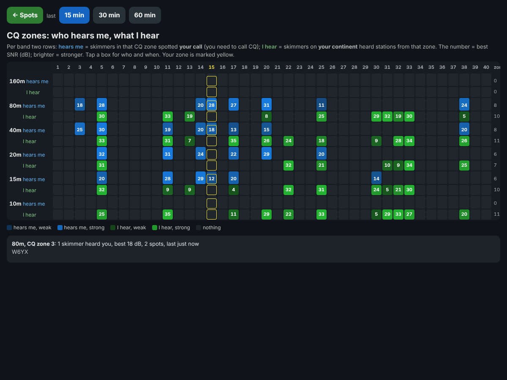
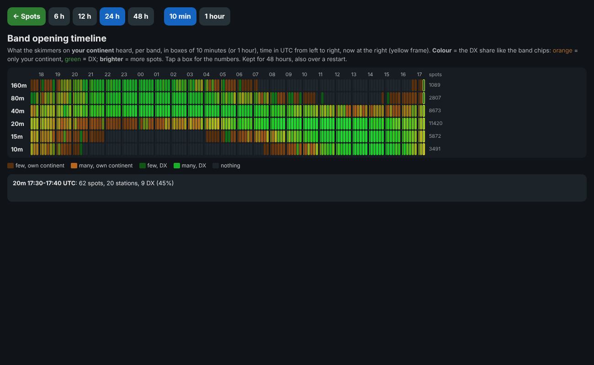

# POUNCer symbols and colours

This page lists every mark, colour and badge you see in POUNCer: first the
Windows / macOS window, then the phone page. Hold the mouse over most of
them in the window (or long-press on the phone) for a short explanation.

## Window

### Top bar (dark strip)

| What you see | Meaning |
| --- | --- |
| **14025.3** (big) | the frequency of the radio POUNCer follows, in kHz, with its band, mode and CW speed |
| **▶ list: 20m** | you clicked a band chip: the list shows that band, not the radio's band. It goes back by itself when the radio changes band; click the chip again to go back now |
| **✓ READY** (green) | the pre-contest check is all good |
| **⚠ CHECK** (amber) | something should be looked at (an old country file, the clock a few seconds off, ...) |
| **✗ NOT READY** (red) | something POUNCer needs is not working (no radio info, no log, no RBN, ...) |
| **MASTER** (green) | team: this POUNCer holds the RBN connection and feeds the others |
| **SLAVE** (blue) | team: this POUNCer gets its spots from the master |
| **TEAM: ALONE** (grey) | team is on, but no other POUNCer is on the network |
| **TEAM OFF** (dark) | team is switched off |
| team badge **orange** | a team POUNCer runs a different version (the tooltip says which IP and version) |

Click the READY badge for the list of checks. Each one is shown with
**✓** (good), **⚠** (look at it) or **✗** (not working):

| Check | ✓ when | ⚠ / ✗ when |
| --- | --- | --- |
| N1MM | radio info arrives | ✗ no radio info for 30 s (N1MM: Config > Broadcast Data > Radio) |
| Log | a contest log is open | ⚠ N1MM's ini names another contest than today's QSOs · ✗ no log open |
| Call | your station call is known | ✗ no station call |
| RBN | spots arrive (directly, through the HTTP backup or from the team master) | ✗ no spots |
| cty | country file loaded, 60 days old or less | ⚠ older · ✗ not loaded (no mults / DX) |
| SCP | Super Check Partial loaded, 30 days old or less | ⚠ older or not loaded (no **?** marks) |
| Phone | the phone page runs | ✗ it could not start (port in use) |
| Clock | PC clock within 5 s of a time server (NTP) | ⚠ 5 - 60 s off · ✗ more than a minute off. "PC 8 s fast" / "PC 8 s slow" |

A check that is switched off isn't shown.

### Connection lights

One coloured dot per connection, under the top bar:

| Colour | Meaning |
| --- | --- |
| 🟢 green | connected and working |
| 🟡 amber | waiting, connecting, or only partly working |
| 🔴 red | not working |
| ⚪ grey | switched off |
| 🔵 blue | Update only: a new version is downloaded - click it (or **Restart**) |

The lights are RBN, N1MM, Log, Team, Phone, SSB (the DX cluster for SSB
spots), Warm-up and Update. What each colour means per light is in the
[README](../README.md#connection-lights-windows-window). Click the
**Update** light to check for a new version now.

### Band chips (band open lights)

One chip per contest band. They count what skimmers **on your continent**
heard in the last 10 minutes.

| What you see | Meaning |
| --- | --- |
| **20m: 34 DX 85%** | 34 different stations from other continents heard; 85 % of everything heard on the band is DX. 5 or more DX stations = the band is **open** |
| **· 6 mults** on a chip | 6 stations spotted on that band right now would be a new multiplier there |
| **80m: EU only** | spots, but (almost) only from your own continent: the band is open locally only |
| **160m: –** | nothing heard: the band is closed (or quiet) |
| chip colour | goes from **orange** (all from your continent) through yellow to **green** (all DX), in proportion to the DX share. **Grey** = nothing heard |
| thin frame | the band your radio is on |
| thick frame and **▶** | the band the list is showing (you clicked the chip) |

Click a chip to see that band's spots; click it again, or change band on
the radio, to follow the radio again.

### Info lines (grey area)

The values in bold - spotter, mode, spot counts, ports, IPs, the CW and SSB
warm-up counts - are what POUNCer is doing right now; the plain text around
them only says what they are.

### Spot list

Text colour (one per row; the first that fits):

| Colour | Meaning |
| --- | --- |
| grey | already worked on this band and mode |
| **red, bold** | a new multiplier on this band |
| green | strong on the skimmer: 20 dB or more |
| black | everything else |

Row background (one per row):

| Colour | Meaning |
| --- | --- |
| light blue | your radio is on this frequency |
| light orange | DX: the station is outside your continent |
| very light grey | every other row, only to make the list easier to read |

Marks in the call and Mult columns:

| Mark | Meaning |
| --- | --- |
| **⚡** before the call | rare CQ: this station runs under 30 % of its QSOs, or is on for under 6 hours, in the past years of this contest - work it now |
| **?** after the call | not in Super Check Partial: maybe a busted (misread) call |
| **↻3m** after the call | you clicked this station 3 minutes ago; **↻3m×2** = clicked twice, the last time 3 minutes ago |
| **M** in the Mult column | one new multiplier |
| **MM** in the Mult column | a double multiplier (for example a new country and a new zone) |

### Buttons and popups

| What you see | Meaning |
| --- | --- |
| sort key filled **blue** | the list is sorted by this key |
| **▲** / **▼** in a column heading | sorted up / down by that column |
| **ENTER** (green) | logs the QSO in N1MM |
| **F1 ... F12** | send N1MM's function key: they **transmit** (the edge turns red under the mouse) |
| **Radio A / Radio B** | which radio POUNCer follows. Shown only when N1MM reports two radios / VFOs |
| **CW 30 WPM ▲** / **▼** popup | the CW speed was changed in N1MM: up or down |
| **min SNR** box | spots weaker than this are not listed (0 = all) |

## Phone page

### A tile

| What you see | Meaning |
| --- | --- |
| **green** tile | strong on the skimmer: 20 dB or more; **grey** = weaker |
| **yellow** call | DX (outside your continent); white = your own continent |
| **pink stripe** on the left | a new multiplier on this band: thin = single, thick = double |
| **light blue outline** | your radio is on this frequency (within 0.5 kHz) |
| **yellow ring** | the tile you tapped last |
| **faded** tile | not re-spotted for 5 minutes - probably gone |
| **yellow flash** | calm list only: a new station just added at the end |
| tile goes **dark** while held | hold on: after 2 s it is removed from the list |
| **⚡** after the call | rare CQ (see above) |
| orange **?** after the call | not in Super Check Partial: maybe a busted call |
| blue **↻3m** | you tapped it 3 minutes ago |
| **7003.1** (bold) | spot frequency in kHz; the mode is shown only when it isn't CW |
| **R6% ~4h** | run history: 6 % of its QSOs made running, about 4 hours on the air in this contest's past logs; **\*** = a reconstructed log |
| **1132Z** | first spotted on this frequency (UTC) |
| **22dB** | skimmer SNR |
| **cq3m** | calling on this frequency for 3 minutes |

### Keys

| Key | Meaning |
| --- | --- |
| **POUNCer** (title) | tap for the band menu (pick a band, alerts on/off) |
| **A / B** | which radio this phone works: blue = A, orange = B. Shown only when N1MM runs two radios |
| **CLR** (red text) | clear all spots (e.g. old ones before the contest); undo for 5 s |
| **Time / Freq / SNR** | sort keys; the active one is green |
| **SNR** with a small **≥10** | only spots of 10 dB or more are listed. **Hold SNR 1.3 s** to set the minimum |
| **DX** (yellow text) | DX on top; filled amber when on |
| **MLT** (pink text) | new multipliers on top (double, then single); filled magenta when on |
| **⚡** | rare CQs on top; filled brown when on |
| **↻ Log** | re-read which log N1MM has open |
| **F-keys** (big name, label underneath) | send N1MM's function key: they **transmit** |
| **ENTER** (green) | N1MM's Enter (log / send). **Hold it 1.3 s** for the CW keyboard; it fills up while you hold |
| **WPM − / WPM +** | N1MM's CW speed down / up (PgDn / PgUp); the speed is shown between them |
| **−25 Hz / +25 Hz** | move the VFO, no TX |
| **NEXT ▶** | the next station of the list: QSY + call, like tapping its tile. No TX |

### Status line and band menu

| What you see | Meaning |
| --- | --- |
| **(+12 weak)** | 12 spots are hidden by the minimum SNR (hold SNR to change it) |
| **calm** | calm list: tiles keep their place and are re-sorted every 15 s |
| **⚠ cty** (or another check) | the pre-contest check found something; tap it for the details |
| **20m list · ...** | you picked a band in the band menu; the list shows that band, not the radio's |
| **⚠ backup skimmers** | the main skimmer went quiet; other skimmers on your continent are used |
| **?** | opens the help on the phone |
| dot in the band menu | band open light, coloured orange (only your continent) to green (DX), with the DX count when open; grey = nothing heard |
| pink **6M** in the band menu | 6 stations spotted on that band would be a new multiplier |

### Messages after a tap

| What you see | Meaning |
| --- | --- |
| **QSY OK1BB ...** | the tap reached POUNCer |
| **✓ OK1BB: radio on 7012.0 · call in** | N1MM moved the radio there and the call is in the Entry Window |
| **⚠ OK1BB: N1MM didn't report 7012.0** | N1MM didn't confirm the new frequency - look at the radio |
| **⚠ ... no answer from POUNCer** | POUNCer didn't answer in 8 s - is it running? |

### CW keyboard (hold ENTER 1.3 s)

| What you see | Meaning |
| --- | --- |
| **TX** | what you type goes to N1MM's CW window (Ctrl+K) as you type; Backspace removes letters not sent yet |
| **DONE ⏎** | N1MM sends the rest and closes its CW window |
| **STOP (Esc)** | stop sending at once |

## CQ zones page

*(example data)*

| What you see | Meaning |
| --- | --- |
| **blue** box, row *hears me* | skimmers in that CQ zone spotted your call on that band; the number = best SNR (dB) |
| **green** box, row *I hear* | skimmers on your continent heard stations from that zone |
| brighter box | stronger (about 3 dB = darkest, 30 dB or more = brightest) |
| dark box | nothing in the chosen time (15 min by default) |
| **yellow** column / frame | your own CQ zone |
| small number after *hears me* / *I hear*, and the *zones* column | how many zones that row has |

## Band opening timeline

*(example data)*

| What you see | Meaning |
| --- | --- |
| a row | one band, 160 m at the top |
| a box | 10 minutes (or 1 hour with **1 hour**), time in UTC from left to right |
| **orange** box | heard by skimmers on your continent: (almost) only your own continent |
| **green** box | mostly DX (other continents); in between = mixed |
| brighter box | more spots in those 10 minutes |
| dark box | nothing heard |
| **yellow** frame | now (the 10 minutes running) |
| number after a row | spots on that band in the time shown |
